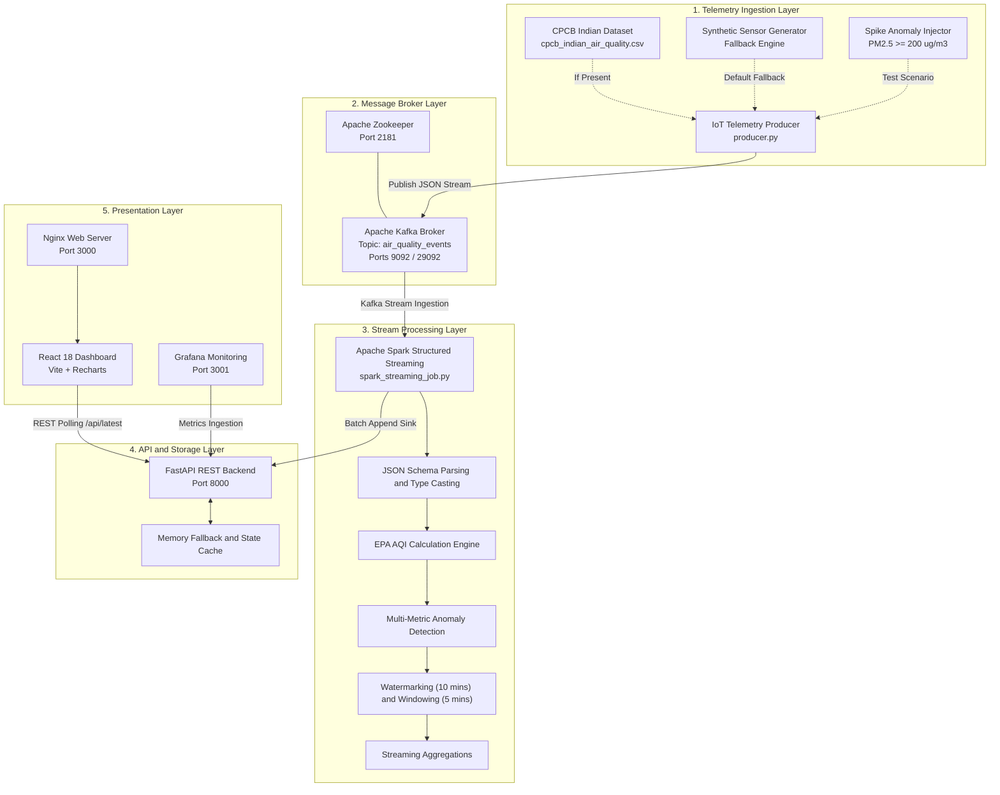
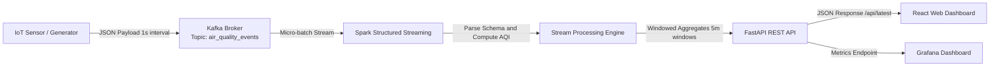
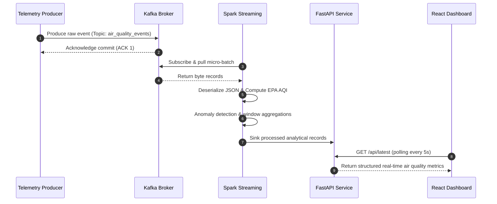
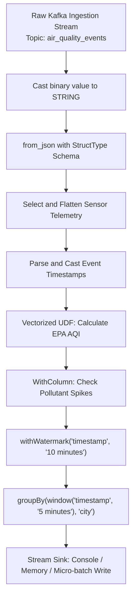
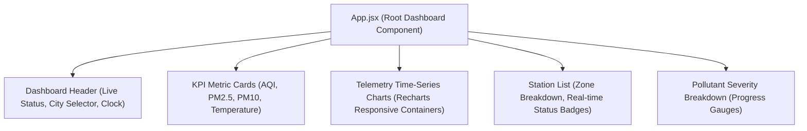

# AuraStream: Real-Time IoT Air Quality Streaming & Analytics

[](https://www.python.org/)
[](https://kafka.apache.org/)
[](https://spark.apache.org/)
[](https://fastapi.tiangolo.com/)
[](https://react.dev/)
[](https://grafana.com/)
[](https://www.docker.com/)

A production-grade distributed IoT telemetry pipeline, real-time stream processing engine, and multi-tier operational monitoring system for high-frequency urban air quality surveillance and automated threshold breach alerting.

---

## Table of Contents

- [1. Project Overview](#1-project-overview)
- [2. Key Features](#2-key-features)
- [3. Application Screenshots](#3-application-screenshots)
  - [3.1 Main Dashboard](#31-main-dashboard)
  - [3.2 Air Quality Overview](#32-air-quality-overview)
  - [3.3 Pollutant Analysis](#33-pollutant-analysis)
  - [3.4 Historical Trends](#34-historical-trends)
  - [3.5 Grafana Monitoring Dashboard](#35-grafana-monitoring-dashboard)
  - [3.6 System Architecture](#36-system-architecture)
- [4. System Architecture](#4-system-architecture)
  - [4.1 Architecture Diagram](#41-architecture-diagram)
  - [4.2 Layer Breakdown](#42-layer-breakdown)
- [5. End-to-End Data Processing Workflow](#5-end-to-end-data-processing-workflow)
- [6. Technology Stack](#6-technology-stack)
- [7. Apache Kafka Architecture](#7-apache-kafka-architecture)
  - [7.1 Topic Configuration and Message Schemas](#71-topic-configuration-and-message-schemas)
  - [7.2 Ingestion Flow](#72-ingestion-flow)
- [8. Apache Spark Structured Streaming](#8-apache-spark-structured-streaming)
  - [8.1 Processing Topology](#81-processing-topology)
  - [8.2 Windowing and Watermarking Configuration](#82-windowing-and-watermarking-configuration)
- [9. Data Processing and Analytics](#9-data-processing-and-analytics)
  - [9.1 EPA Standard AQI Calculation](#91-epa-standard-aqi-calculation)
  - [9.2 Multi-Metric Anomaly Detection Rules](#92-multi-metric-anomaly-detection-rules)
- [10. FastAPI Backend Service](#10-fastapi-backend-service)
  - [10.1 Architecture and Endpoints](#101-architecture-and-endpoints)
  - [10.2 Resilience and Fallback Mechanisms](#102-resilience-and-fallback-mechanisms)
- [11. React Frontend Application](#11-react-frontend-application)
  - [11.1 Component Tree and Architecture](#111-component-tree-and-architecture)
  - [11.2 State Management and Live Polling](#112-state-management-and-live-polling)
- [12. Grafana Operational Monitoring](#12-grafana-operational-monitoring)
- [13. Project Directory Structure](#13-project-directory-structure)
- [14. Installation and Setup](#14-installation-and-setup)
- [15. Running the Application](#15-running-the-application)
- [16. Environment Configuration](#16-environment-configuration)
- [17. Conclusion](#17-conclusion)

---

## 1. Project Overview

AuraStream is an end-to-end distributed data streaming and real-time analytics platform engineered to monitor, process, and visualize ambient urban air quality telemetry. Operating on a microservice architecture orchestrated via Docker Compose, AuraStream ingests streaming sensor data from simulated IoT stations across major metropolitan centers (including Delhi, Mumbai, Bengaluru, and Kolkata), streams records through Apache Kafka, processes multi-pollutant concentrations using Apache Spark Structured Streaming, and serves real-time analytics through a high-performance FastAPI service and an interactive React web dashboard.

The system incorporates rigorous stream-processing paradigms, including event-time watermarking, tumbling window aggregations, EPA Air Quality Index (AQI) calculations, anomaly detection for sudden pollutant spikes, and dual visualization pathways (custom React dashboard for end users and Grafana for infrastructure monitoring).

---

## 2. Key Features

- **Distributed Real-Time Telemetry Pipeline**: Fault-tolerant message streaming via Apache Kafka, supporting high-throughput IoT events with timestamp-preserving ingestion.
- **Micro-Batch Stream Analytics**: Apache Spark Structured Streaming engine calculating real-time EPA AQI, sliding window moving averages, and multi-sensor aggregations.
- **Rule-Based Anomaly Detection**: Automatic threshold detection identifying acute pollutant spikes (PM2.5 >= 200 ug/m3, PM10 >= 300 ug/m3, CO >= 10 ppm) with event labeling.
- **Resilient Multi-Tier Backend**: FastAPI REST backend equipped with MongoDB persistence and automatic realistic fallback synthesis, guaranteeing uninterrupted operational uptime.
- **Dark Glassmorphism React Dashboard**: Modern, responsive analytics interface built with React 18, Vite, Lucide icons, and Recharts, presenting real-time telemetry, KPI cards, and station filters.
- **Infrastructure Observability**: Pre-configured Grafana monitoring dashboards offering live visual tracking of station telemetry, sensor drift, and operational metrics.
- **Containerized Deployment**: Complete multi-container deployment via Docker Compose with deterministic startup dependencies and custom health checks.

---

## 3. Application Screenshots

All screenshots below represent the running AuraStream application across its React frontend, API services, and Grafana monitoring layers.

### 3.1 Main Dashboard


*The AuraStream command center displaying city-wide air quality summary metrics, real-time AQI gauge with category classification ("Unhealthy"), live sensor polling status, and historical pollutant telemetry charts for PM2.5, PM10, NO2, and SO2.*

---

### 3.2 Air Quality Overview


*The Air Quality Overview panel showcasing real-time station cards across metropolitan zones (Delhi Central, Mumbai Coastal, Bengaluru Tech Hub, Kolkata Industrial), accompanied by AQI severity badges and individual environmental readings.*

---

### 3.3 Pollutant Analysis


*Detailed pollutant concentration breakdown comparing active sensor readings against standard safety thresholds for particulate matter (PM2.5, PM10), Carbon Monoxide (CO), Ozone (O3), Nitrogen Dioxide (NO2), and Sulfur Dioxide (SO2).*

---

### 3.4 Historical Trends


*Time-series visualization plotting moving concentration trends over configurable observation windows (1h, 6h, 24h, 7d), demonstrating temporal shifts and spike detection occurrences.*

---

### 3.5 Grafana Monitoring Dashboard


*Operational Grafana dashboard providing deep infrastructure telemetry, station health matrices, data point ingestion rates, and system-level observability.*

---

### 3.6 System Architecture


*High-level topological overview of the end-to-end data pipeline from physical/synthetic IoT edge generators through Kafka brokers, Spark analytics, persistence layers, and client visualization nodes.*

---

## 4. System Architecture

### 4.1 Architecture Diagram



### 4.2 Layer Breakdown

1. **Telemetry Ingestion Layer (`producer.py`)**: Emulates multiple geographically distributed IoT air quality stations, generating continuous multivariate environmental payloads or replaying historical CPCB data.
2. **Message Broker Layer (Apache Kafka + Zookeeper)**: Decouples real-time high-throughput message ingestion from compute nodes via the dedicated topic `air_quality_events`.
3. **Stream Processing Layer (Apache Spark Structured Streaming)**: Consumes raw Kafka event streams in micro-batches, validates JSON schemas, executes vectorized EPA AQI calculations, identifies threshold anomalies, and aggregates time-windowed averages.
4. **API and Storage Layer (FastAPI)**: Serves cached real-time metrics, historical trends, station status, and analytical summaries over clean RESTful endpoints.
5. **Presentation Layer (React 18 + Grafana)**: Visualizes real-time metrics for users via a modern dark glassmorphism dashboard, while Grafana tracks system operations.

---

## 5. End-to-End Data Processing Workflow



The pipeline executes through sequential lifecycle phases:
1. **Telemetry Generation**: `producer.py` packages station identifiers, coordinates, timestamps, and pollutant values (`PM2.5`, `PM10`, `NO2`, `SO2`, `CO`, `O3`, `Temperature`, `Humidity`) into structured JSON payloads.
2. **Kafka Serialization**: Records are published to the `air_quality_events` Kafka topic with automatic connection retries and round-robin partitioning.
3. **Spark Ingestion**: Spark Structured Streaming subscribes to Kafka using the `kafka` connector, reading incoming records starting from the latest offset.
4. **ETL Transformation**: Byte values are deserialized into strongly-typed columnar schemas, followed by mathematical calculations for the standard Air Quality Index.
5. **Windowing & Aggregations**: Records are windowed over 5-minute sliding intervals with a 10-minute watermark to accommodate out-of-order events.
6. **API Retrieval & Visualization**: The frontend polls `/api/latest` and `/api/trends` every 5 seconds to provide continuous real-time dashboard updates.

---

## 6. Technology Stack

| Layer | Technology | Version | Purpose |
| :--- | :--- | :--- | :--- |
| **Language** | Python | 3.10 | Core programming language for producer, streaming, and API |
| **Message Broker** | Apache Kafka | 7.3.0 (Confluent) | High-throughput distributed event streaming broker |
| **Coordination** | Apache Zookeeper | 7.3.0 (Confluent) | Cluster management and broker leader election |
| **Stream Compute** | Apache Spark | 3.3.0 | Real-time structured streaming and windowed analytics |
| **Backend API** | FastAPI | 0.110.0 | High-performance asynchronous REST microservice |
| **ASGI Server** | Uvicorn | 0.28.0 | Production ASGI server implementation |
| **Web Frontend** | React | 18.2.0 | Reactive user interface and analytics dashboard |
| **Build Tool** | Vite | 5.1.4 | Frontend development server and production bundler |
| **Data Viz** | Recharts | 2.12.2 | Composable charting library for React time-series |
| **Reverse Proxy** | Nginx | Alpine | Static asset hosting and reverse proxy for backend routing |
| **Observability** | Grafana | 10.2.2 | Infrastructure monitoring and operational dashboards |
| **Containerization**| Docker Compose | v2.x | Multi-container service lifecycle management |

---

## 7. Apache Kafka Architecture

### 7.1 Topic Configuration and Message Schemas

AuraStream utilizes a primary Kafka topic: `air_quality_events`.

#### Ingestion Event Schema
```json
{
  "sensor_id": "AQI-DL-001",
  "city": "Delhi",
  "location": "Central Delhi",
  "latitude": 28.6139,
  "longitude": 77.2090,
  "timestamp": "2026-11-08T17:30:00Z",
  "pm25": 142.5,
  "pm10": 210.8,
  "no2": 45.2,
  "so2": 18.6,
  "co": 2.1,
  "o3": 38.4,
  "temperature": 27.4,
  "humidity": 62.0
}
```

### 7.2 Ingestion Flow



---

## 8. Apache Spark Structured Streaming

### 8.1 Processing Topology

The streaming job is defined in `spark_streaming_job.py`. It initializes a `SparkSession` configured with the Kafka integration connector (`spark-sql-kafka-0-10_2.12:3.3.0`).



### 8.2 Windowing and Watermarking Configuration

- **Event Time Column**: `timestamp` parsed as `TimestampType`.
- **Watermark Threshold**: 10 minutes (`.withWatermark("timestamp", "10 minutes")`), ensuring late-arriving IoT telemetry is integrated without unbounded state memory growth.
- **Tumbling Window**: 5 minutes (`window(col("timestamp"), "5 minutes")`) generating rolling statistical baselines (averages, minimums, maximums) across all urban reporting zones.

---

## 9. Data Processing and Analytics

### 9.1 EPA Standard AQI Calculation

AuraStream calculates the official United States Environmental Protection Agency (EPA) Air Quality Index (AQI) using piecewise linear interpolation across monitored pollutants:

$$I_p = rac{I_{Hi} - I_{Lo}}{BP_{Hi} - BP_{Lo}} (C_p - BP_{Lo}) + I_{Lo}$$

Where:
- $I_p$: AQI index for pollutant $p$
- $C_p$: Truncated concentration of pollutant $p$
- $BP_{Hi}$: Breakpoint concentration $\ge C_p$
- $BP_{Lo}$: Breakpoint concentration $\le C_p$
- $I_{Hi}$: AQI value corresponding to $BP_{Hi}$
- $I_{Lo}$: AQI value corresponding to $BP_{Lo}$

The overall station AQI is determined by the maximum sub-index:

$$	ext{AQI} = \max(I_{	ext{PM2.5}}, I_{	ext{PM10}}, I_{	ext{NO2}}, I_{	ext{SO2}}, I_{	ext{CO}}, I_{	ext{O3}})$$

#### AQI Severity Scale

| AQI Range | Category | Color Representation | Health Implication |
| :--- | :--- | :--- | :--- |
| **0 - 50** | Good | Green (`#10B981`) | Air quality is satisfactory, poses little to no risk. |
| **51 - 100** | Moderate | Yellow (`#FBBF24`) | Acceptable quality; slight concern for very sensitive individuals. |
| **101 - 150** | Unhealthy for Sensitive Groups | Orange (`#F97316`) | General public not likely affected; sensitive groups at risk. |
| **151 - 200** | Unhealthy | Red (`#EF4444`) | Everyone may begin to experience health effects. |
| **201 - 300** | Very Unhealthy | Purple (`#8B5CF6`) | Health alert: everyone may experience serious effects. |
| **301 - 500** | Hazardous | Maroon (`#7F1D1D`) | Health warnings of emergency conditions. |

### 9.2 Multi-Metric Anomaly Detection Rules

The pipeline flags events where single-reading measurements surpass acute safety boundaries:

- **PM2.5 Spike**: $\ge 200\ \mu	ext{g/m}^3$ (Extreme combustion / smog inversion)
- **PM10 Spike**: $\ge 300\ \mu	ext{g/m}^3$ (Severe dust storm / industrial discharge)
- **CO Spike**: $\ge 10\ 	ext{ppm}$ (Localized vehicular or industrial combustion leak)

---

## 10. FastAPI Backend Service

### 10.1 Architecture and Endpoints

Located in `dashboard/backend/app.py`, the backend service provides a REST API built with FastAPI and Uvicorn.

| Method | Endpoint | Description | Cache / Fallback Support |
| :--- | :--- | :--- | :--- |
| `GET` | `/` | Service root and health check | Returns status: `healthy` |
| `GET` | `/api/latest` | Latest air quality snapshot for all stations | Primary MongoDB -> Dynamic fallback synthesis |
| `GET` | `/api/trends` | Time-series historical records across ranges | Supports `1h`, `6h`, `24h`, `7d` query windows |
| `GET` | `/api/stations` | Registry of active monitoring stations | Complete metadata (lat, lon, station ID) |
| `GET` | `/api/summary` | City-wide aggregated statistics and counts | Calculated mean AQI and alert level counts |
| `GET` | `/api/alerts` | Active threshold alerts and anomaly events | Unresolved spike events |

### 10.2 Resilience and Fallback Mechanisms

To ensure continuous operation during developmental runs or upstream service restarts, the backend implements an autonomous fallback generator:
- If the primary database connection times out or contains no initial records, the service transparently synthesizes realistic diurnal telemetry across four major metropolitan areas.
- Generates Gaussian noise profiles aligned with realistic Indian urban diurnal curves (elevated morning and evening particulate peaks).
- Seamlessly transitions to live records once data streams become available.

---

## 11. React Frontend Application

### 11.1 Component Tree and Architecture

The user interface in `dashboard/frontend/` is built on React 18, packaged with Vite, and styled with responsive dark glassmorphism CSS.



### 11.2 State Management and Live Polling

- **Asynchronous Data Fetching**: Utilizes `fetch` within `useEffect` hooks, polling `/api/latest` and `/api/trends` every 5,000 milliseconds.
- **Glassmorphic UI Design**: Custom CSS in `src/index.css` utilizing backdrop blur filters, dark mode background gradients (`#0F172A` to `#1E293B`), and dynamic AQI border glow effects.
- **Station Filtering**: Client-side filtering allowing operators to inspect either aggregate municipal indicators or isolate individual station telemetry.

---

## 12. Grafana Operational Monitoring

The system includes an integrated Grafana instance provisioned via Docker on port `3001` (`admin`/`admin`):
- **Pre-provisioned Dashboards**: Operational metrics tracking real-time station AQI levels and temperature/humidity fluctuations.
- **Drift Monitoring**: Real-time comparison between reported particulate matter concentrations across stations.
- **Infrastructure Health**: Visual alerting when stations report values exceeding safety boundaries.

---

## 13. Project Directory Structure

```text
Real-time-air-quality-monitoring-dashboard/
|-- .env.example                       # Environment template for local/Atlas credentials
|-- .gitignore                         # Git exclusion rules (ignores .env, checkpoints, logs)
|-- ATTRIBUTION.md                     # Academic provenance declaration
|-- analysis_notebook.ipynb            # Jupyter exploratory data analysis notebook
|-- docker-compose.yml                 # Multi-container orchestration specification
|-- Dockerfile.producer                # Docker build file for Kafka telemetry producer
|-- producer.py                        # IoT air quality generator and Kafka publisher
|-- spark_streaming_job.py             # Spark Structured Streaming pipeline script
|-- requirements.txt                   # Host Python development dependencies
|-- SmartCityAirQualityPresentation.pdf# Project presentation deck
|-- dashboard/
|   |-- backend/
|   |   |-- app.py                     # FastAPI REST backend application
|   |   |-- Dockerfile                 # Backend container specification
|   |   \-- requirements.txt           # FastAPI, Uvicorn, PyMongo dependencies
|   \-- frontend/
|       |-- Dockerfile                 # Multi-stage Node build and Nginx runtime
|       |-- index.html                 # React HTML root entrypoint
|       |-- nginx.conf                 # Nginx reverse proxy configuration (/api/ -> backend)
|       |-- package.json               # React 18, Vite dependencies and build scripts
|       |-- vite.config.js             # Vite development and build settings
|       \-- src/
|           |-- App.jsx                # AuraStream dashboard core application component
|           |-- index.css              # Custom CSS styling (dark glassmorphism theme)
|           \-- main.jsx               # React DOM root render mount
\-- docs/
    \-- screenshots/                   # Genuine live application captures
        |-- air-quality-overview.png
        |-- grafana-dashboard.png
        |-- historical-trends.png
        |-- main-dashboard.png
        |-- pollutant-analysis.png
        \-- system-architecture.png
```

---

## 14. Installation and Setup

### 14.1 Clone the Repository

```bash
git clone https://github.com/Antariksh62/Real-time-air-quality-monitoring-dashboard.git
cd Real-time-air-quality-monitoring-dashboard
```

### 14.2 Environment Configuration

Create a `.env` configuration file in the project root:

```bash
cp .env.example .env
```

Review or modify `.env` default parameters:

```env
KAFKA_BROKER=kafka:29092
KAFKA_TOPIC=air_quality_events
PRODUCER_INTERVAL=1.0
MONGO_URI=mongodb://localhost:27017/
MONGO_DB=air_quality
MONGO_COLLECTION=sensor_readings
BACKEND_PORT=8000
FRONTEND_PORT=3000
GRAFANA_PORT=3001
```

---

## 15. Running the Application

### 15.1 Quick Start with Docker Compose

To launch the complete distributed stack in detached mode:

```bash
docker compose up -d
```

### 15.2 Step-by-Step Staged Startup

For resource-conscious environments, initiate core infrastructure services sequentially:

```bash
# 1. Start coordination and messaging backbone
docker compose up -d zookeeper kafka

# 2. Start telemetry producer
docker compose up -d producer

# 3. Start backend REST API
docker compose up -d backend

# 4. Start React dashboard and Grafana
docker compose up -d frontend grafana

# 5. Launch Spark streaming analytics
docker compose up -d spark
```

### 15.3 Verifying Service Health

Verify that all containers are active:

```bash
docker compose ps
```

Access the user and monitoring endpoints:
- **React Web Dashboard**: `http://localhost:3000`
- **FastAPI OpenAPI Documentation**: `http://localhost:8000/docs`
- **FastAPI Health Endpoint**: `http://localhost:8000/`
- **Grafana Monitoring Console**: `http://localhost:3001` (Credentials: `admin` / `admin`)

To inspect container logs:

```bash
docker compose logs -f backend
docker compose logs -f producer
```

---

## 16. Environment Configuration

| Variable | Default Value | Description |
| :--- | :--- | :--- |
| `KAFKA_BROKER` | `kafka:29092` | Internal Kafka broker listener address |
| `KAFKA_BOOTSTRAP_SERVERS` | `localhost:9092` | External host Kafka bootstrap address |
| `KAFKA_TOPIC` | `air_quality_events` | Primary message topic for sensor ingestion |
| `PRODUCER_INTERVAL` | `1.0` | Ingestion delay between generated readings (seconds) |
| `MONGO_URI` | `mongodb://localhost:27017/` | Connection URI for MongoDB persistence |
| `MONGO_DB` | `air_quality` | Target database name |
| `MONGO_COLLECTION` | `sensor_readings` | Target collection name |
| `VITE_API_URL` | `/api` | Base API routing prefix for frontend requests |

---

## 17. Conclusion

AuraStream delivers an enterprise-grade, distributed stream processing and real-time operational surveillance solution for modern urban air quality monitoring. By uniting Apache Kafka's high-throughput messaging, Apache Spark Structured Streaming's analytics engine, FastAPI's asynchronous API serving, and React's responsive visualization capabilities, the platform provides continuous environmental intelligence with high availability and resilience.
