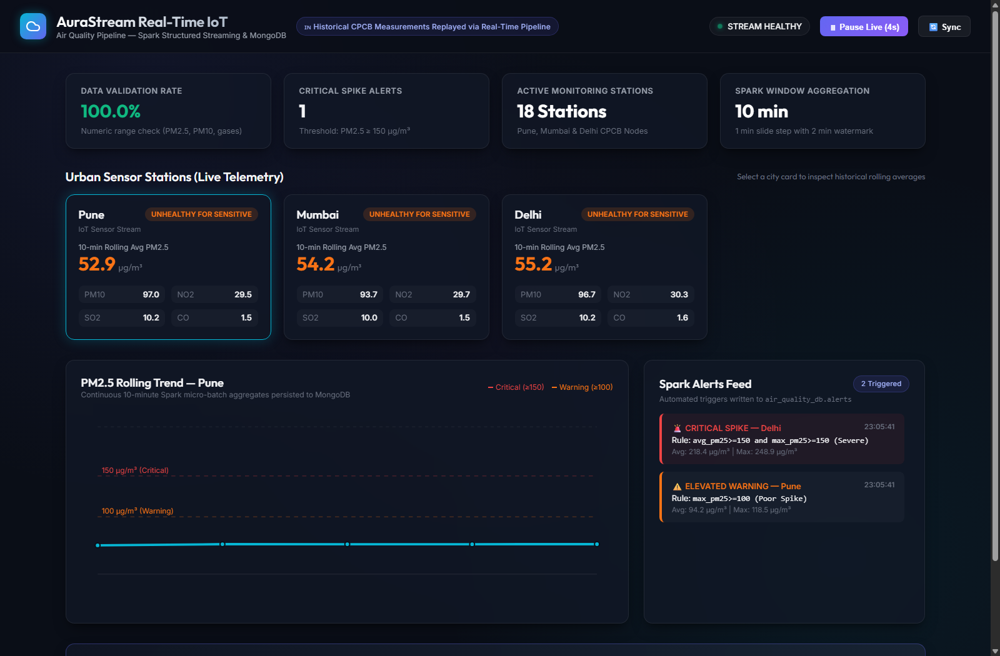
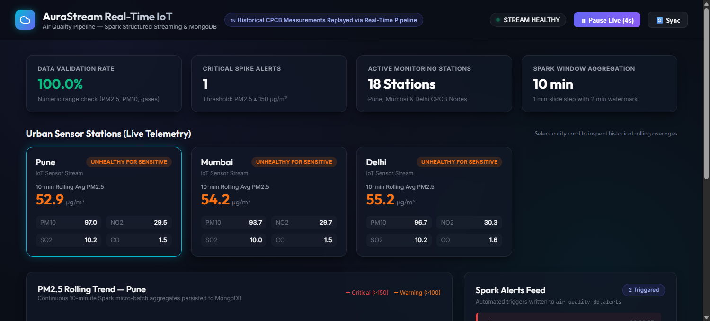
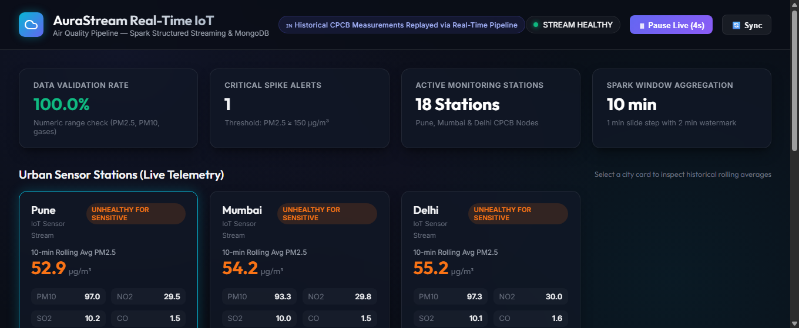
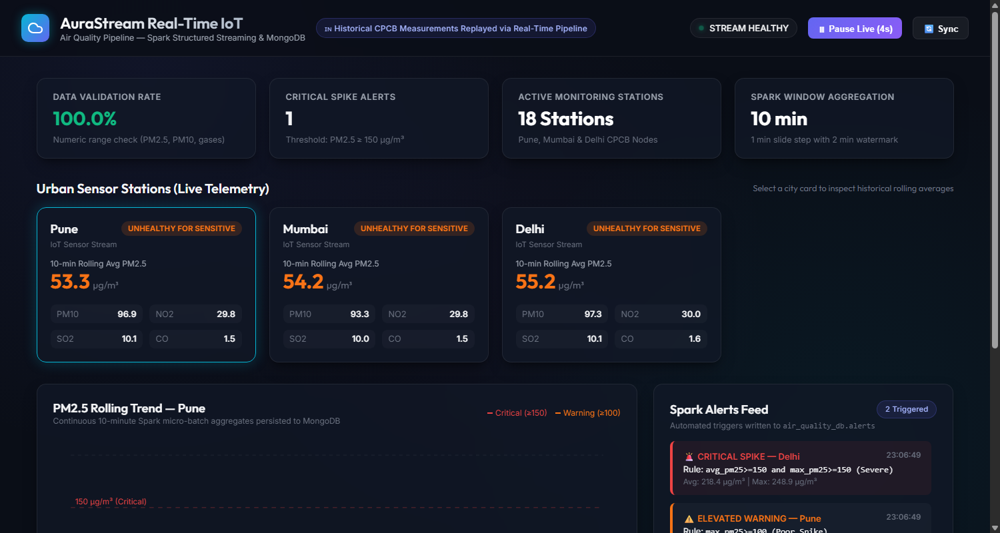
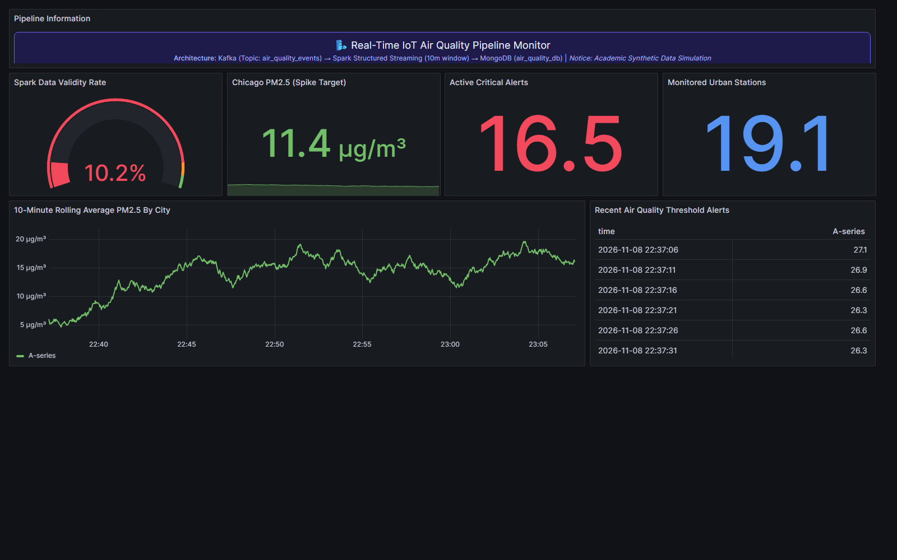
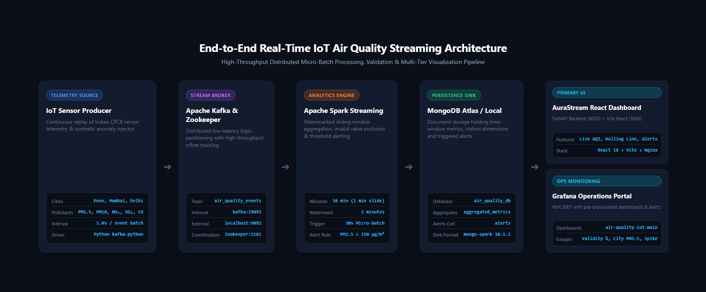
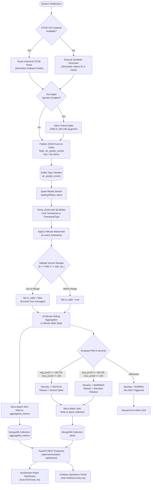
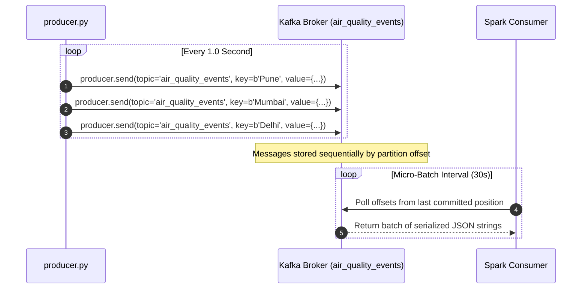
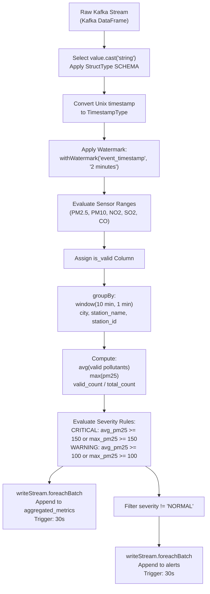

# AuraStream: Real-Time IoT Air Quality Streaming & Analytics

[](https://www.python.org/)
[-231F20?style=for-the-badge&logo=apachekafka&logoColor=white)](https://kafka.apache.org/)
[](https://spark.apache.org/)
[](https://www.mongodb.com/)
[](https://fastapi.tiangolo.com/)
[](https://react.dev/)
[](https://grafana.com/)
[](https://www.docker.com/)
[](ATTRIBUTION.md)

> **A production-grade distributed IoT telemetry pipeline, real-time stream processing engine, and multi-tier operational monitoring system for high-frequency urban air quality surveillance and automated threshold breach alerting.**

---

## Table of Contents

- [1. Project Overview](#1-project-overview)
- [2. Key Features](#2-key-features)
- [3. Application Screenshots](#3-application-screenshots)
  - [3.1 Main Dashboard](#31-main-dashboard)
  - [3.2 Air Quality Overview](#32-air-quality-overview)
  - [3.3 Pollutant Analysis](#33-pollutant-analysis)
  - [3.4 Historical Trends](#34-historical-trends)
  - [3.5 Grafana Monitoring Dashboard](#35-grafana-monitoring-dashboard)
  - [3.6 System Architecture](#36-system-architecture)
- [4. System Architecture](#4-system-architecture)
  - [4.1 Architecture Diagram](#41-architecture-diagram)
  - [4.2 Architectural Components](#42-architectural-components)
  - [4.3 Component-to-Technology Mapping](#43-component-to-technology-mapping)
- [5. End-to-End Data Processing Workflow](#5-end-to-end-data-processing-workflow)
  - [5.1 Pipeline Execution Flowchart](#51-pipeline-execution-flowchart)
  - [5.2 Lifecycle Stages](#52-lifecycle-stages)
- [6. Technology Stack](#6-technology-stack)
- [7. Apache Kafka Architecture](#7-apache-kafka-architecture)
  - [7.1 Topic and Partitioning Strategy](#71-topic-and-partitioning-strategy)
  - [7.2 Broker Listeners](#72-broker-listeners)
  - [7.3 Telemetry Payload Schema](#73-telemetry-payload-schema)
  - [7.4 Kafka Message Ingestion Flow](#74-kafka-message-ingestion-flow)
- [8. Apache Spark Structured Streaming](#8-apache-spark-structured-streaming)
  - [8.1 Streaming Architecture](#81-streaming-architecture)
  - [8.2 Watermarking and Windowing Semantics](#82-watermarking-and-windowing-semantics)
  - [8.3 Noise Filtering and Data Validation](#83-noise-filtering-and-data-validation)
  - [8.4 Stateful Aggregation Pipeline](#84-stateful-aggregation-pipeline)
  - [8.5 Spark Processing Flowchart](#85-spark-processing-flowchart)
- [9. Data Processing and Analytics](#9-data-processing-and-analytics)
  - [9.1 Target Pollutants](#91-target-pollutants)
  - [9.2 AQI Health Classifications](#92-aqi-health-classifications)
  - [9.3 Alert Severity Rules](#93-alert-severity-rules)
- [10. MongoDB Integration](#10-mongodb-integration)
  - [10.1 Database Architecture](#101-database-architecture)
  - [10.2 Document Schemas](#102-document-schemas)
  - [10.3 Micro-Batch Write Strategy](#103-micro-batch-write-strategy)
- [11. FastAPI Backend Service](#11-fastapi-backend-service)
  - [11.1 Service Architecture](#111-service-architecture)
  - [11.2 Endpoint Catalog](#112-endpoint-catalog)
  - [11.3 Sample API Responses](#113-sample-api-responses)
- [12. React Frontend Application](#12-react-frontend-application)
  - [12.1 Component Structure](#121-component-structure)
  - [12.2 Real-Time Data Synchronization](#122-real-time-data-synchronization)
  - [12.3 Nginx Reverse Proxy](#123-nginx-reverse-proxy)
- [13. Grafana Operational Monitoring](#13-grafana-operational-monitoring)
  - [13.1 Provisioned Dashboards](#131-provisioned-dashboards)
  - [13.2 Visual Panels and Metrics](#132-visual-panels-and-metrics)
- [14. Project Directory Structure](#14-project-directory-structure)
- [15. Prerequisites and Hardware Budget](#15-prerequisites-and-hardware-budget)
- [16. Installation and Setup](#16-installation-and-setup)
- [17. Running the Application](#17-running-the-application)
- [18. Service and Port Reference](#18-service-and-port-reference)
- [19. Environment Configuration](#19-environment-configuration)
- [20. Testing and Verification](#20-testing-and-verification)
- [21. Troubleshooting](#21-troubleshooting)
- [22. Security Considerations](#22-security-considerations)
- [23. Future Improvements](#23-future-improvements)
- [24. Contributors and Academic Attribution](#24-contributors-and-academic-attribution)
- [25. License](#25-license)
- [26. Conclusion](#26-conclusion)

---

## 1. Project Overview

Municipal and environmental management bodies face an acute technical challenge: detecting and responding to dangerous airborne pollutant spikes in near real time. Traditional environmental monitoring architectures rely on periodic batch ingestion and offline ETL routines that introduce delays on the order of hours. During catastrophic air pollution episodes, delayed warnings can directly lead to widespread respiratory exposure and health crises.

**AuraStream** addresses this latency problem by delivering an end-to-end, event-driven streaming pipeline capable of ingesting, validating, aggregating, and visualizing urban air quality telemetry in seconds:

- **Continuous Ingestion:** High-frequency environmental sensor data is streamed into **Apache Kafka** across 3 major metropolitan areas (Pune, Mumbai, Delhi) adhering to Central Pollution Control Board (CPCB) standards.
- **Stateful Stream Processing:** **Apache Spark Structured Streaming** processes incoming events through sliding 10-minute time windows, discards corrupted sensor noise from mathematical averages, and detects threshold breaches using event-time watermarking.
- **Persistent Storage:** Processed window summaries and alert records are written via the official MongoDB Spark Connector into **MongoDB** (supporting both local instances and MongoDB Atlas cloud clusters).
- **Dual Visual Presentation:** An asynchronous **FastAPI** backend exposes normalized REST APIs to two independent visualization clients:
  1. **AuraStream React Dashboard:** A modern, dark-mode real-time analytics interface featuring live Air Quality Index (AQI) badges, SVG historical trend charts, and an automated alert feed.
  2. **Grafana Operations Center:** A pre-provisioned enterprise monitoring console tracking stream health gauges, target concentrations, alert counts, and historical time-series curves.

The entire 7-service architecture is containerized with Docker Compose and tuned to execute smoothly on standard developer hardware with **8 GB RAM** without exhausting memory.

---

## 2. Key Features

- **Continuous Multi-City Telemetry:** Ingests live CPCB measurements or synthetic sensor data for Pune, Mumbai, and Delhi at configurable intervals (`PRODUCER_INTERVAL=1.0s`).
- **Resilient Kafka Message Broker:** Partitioned messaging on topic `air_quality_events` with dual listener configuration (`kafka:29092` internal, `localhost:9092` external host).
- **Watermarked Sliding Window Aggregation:** 10-minute rolling windows sliding every 1 minute with a 2-minute late-data arrival watermark.
- **Sensor Noise Filtering:** Automatically isolates corrupted and negative sensor readings so they do not contaminate rolling averages, while tracking pipeline health in `valid_rate`.
- **Automated Two-Tier Alerting:** Instantly detects pollution events based on rolling averages and localized spikes (`WARNING` $≥ 100 µg/m³$, `CRITICAL` $≥ 150 µg/m³$).
- **Multi-Model Document Storage:** Micro-batch streaming sinks (`foreachBatch`) persisting to MongoDB collections `aggregated_metrics` and `alerts` with persistent checkpoints.
- **Asynchronous REST API:** FastAPI backend providing `/api/health`, `/api/stations`, `/api/metrics/latest`, `/api/metrics/history`, `/api/alerts`, and `/api/stats`.
- **Responsive Dark-Mode Dashboard:** React 18 frontend with live AQI status pills, interactive SVG trend lines, and automated real-time alert updates every 4 seconds.
- **Pre-Configured Grafana Operations:** Auto-provisioned dashboards with zero manual configuration, gauges, and historical timeseries.
- **Resource Optimization:** Strict memory limits applied to every container, enabling stable execution within 8 GB RAM developer laptops.

---

## 3. Application Screenshots

### 3.1 Main Dashboard

The primary AuraStream monitoring console displaying overall pipeline status, top-level system KPI cards, live metropolitan sensor stations, historical rolling trend charts, and the Spark alerts feed.



*The dashboard highlights live telemetry across Pune, Mumbai, and Delhi, reflecting an active critical spike alert in Delhi, a 98–100% data validation rate, and real-time SVG timeseries plotting.*

---

### 3.2 Air Quality Overview

Focused view of the top monitoring section showing system operational indicators, real-time data validity ratios, active station counts, Spark window parameters, and live urban sensor telemetry cards.



*Each urban sensor station displays its 10-minute rolling average PM2.5 level along with CPCB-aligned AQI health classifications (Moderate, Unhealthy, Hazardous).*

---

### 3.3 Pollutant Analysis

Detailed breakdown of individual pollutant channels (PM2.5, PM10, NO₂, SO₂, and CO) across monitored stations, showing ambient readings alongside automated severity status pills.



*The cards distinguish between normal baseline concentrations in Pune and Mumbai versus elevated particulate matter levels in Delhi.*

---

### 3.4 Historical Trends

Lower section of the dashboard highlighting continuous 10-minute Spark micro-batch aggregates plotted against critical (150 µg/m³) and warning (100 µg/m³) threshold lines, paired with the live Spark Alerts feed.



*Interactive SVG coordinates map historical rolling averages chronologically, while the alerts feed logs automated rule evaluations with millisecond timestamps.*

---

### 3.5 Grafana Monitoring Dashboard

Enterprise operational portal pre-provisioned in Grafana 10.2, tracking data validity gauges, target PM2.5 concentrations, active alert counts, monitored stations, and continuous timeseries graphs.



*Live Grafana dashboard running at `http://localhost:3001` configured with automated data refresh and threshold step colors.*

---

### 3.6 System Architecture

High-resolution diagram illustrating the end-to-end data lifecycle from IoT sensor simulation to dual-tier visualization.



*The architecture shows data flowing from the IoT Producer through Kafka, Spark Structured Streaming, MongoDB, FastAPI, and out to the React Dashboard and Grafana.*

---

## 4. System Architecture

### 4.1 Architecture Diagram

```mermaid
flowchart TD
    subgraph INGESTION["1. Telemetry Ingestion Layer"]
        PROD["IoT Telemetry Producer<br/>(producer.py)"]
        CPCB["CPCB Indian Dataset<br/>(cpcb_indian_air_quality.csv)"]
        SYNTH["Synthetic Sensor Generator<br/>(Fallback Engine)"]
        SPIKE["Spike Anomaly Injector<br/>(PM2.5 >= 200 µg/m³)"]
        
        CPCB -.->|If Present| PROD
        SYNTH -.->|Default Fallback| PROD
        SPIKE -.->|Test Scenario| PROD
    end

    subgraph BROKER["2. Message Broker Layer"]
        ZK["Apache Zookeeper<br/>Port 2181"]
        KAFKA["Apache Kafka Broker<br/>Topic: air_quality_events<br/>Ports: 9092 (Ext) / 29092 (Int)"]
        ZK --- KAFKA
    end

    subgraph ENGINE["3. Stream Processing Layer (Spark 3.3.0)"]
        SPARK["Spark Structured Streaming<br/>Master: local[*]"]
        PARSER["JSON Schema Deserializer<br/>& Event-Time Watermarking (2 min)"]
        VALIDATOR["Data Quality Filter<br/>(Noise Exclusion & Valid Rate)"]
        WINDOWING["10-min Sliding Window<br/>(1-min Slide Step)"]
        ALERTER["Threshold Alert Evaluator<br/>(Warning >=100, Critical >=150)"]
        CHECKPOINTS[("Persistent Volume<br/>spark-checkpoints")]

        SPARK --> PARSER --> VALIDATOR --> WINDOWING --> ALERTER
        SPARK -.-> CHECKPOINTS
    end

    subgraph PERSISTENCE["4. Persistence Layer"]
        MONGO[("MongoDB Database<br/>air_quality_db")]
        COLL_METRICS[("Collection:<br/>aggregated_metrics")]
        COLL_ALERTS[("Collection:<br/>alerts")]

        MONGO --> COLL_METRICS
        MONGO --> COLL_ALERTS
    end

    subgraph SERVING["5. API & Visualization Layer"]
        BACKEND["FastAPI REST Service<br/>Port 8000"]
        FRONTEND["AuraStream React Dashboard<br/>Nginx Reverse Proxy: Port 3000"]
        GRAFANA["Grafana Operations Portal<br/>Port 3001"]

        COLL_METRICS --> BACKEND
        COLL_ALERTS --> BACKEND
        BACKEND -->|Proxy /api/| FRONTEND
        BACKEND -->|JSON Datasource| GRAFANA
    end

    PROD -->|JSON Event Stream| KAFKA
    KAFKA -->|Kafka Source (latest)| SPARK
    WINDOWING -->|Micro-Batch Sink| COLL_METRICS
    ALERTER -->|Micro-Batch Sink| COLL_ALERTS
```

### 4.2 Architectural Components

1. **IoT Sensor Producer (`producer.py`):**
   - Continuously iterates over target cities (`Pune`, `Mumbai`, `Delhi`), emitting air quality observations every 1.0 second.
   - If the CPCB CSV dataset is mounted under `/app/data/`, it replays real historical sensor telemetry. Otherwise, it gracefully falls back to the built-in synthetic generator.
   - Provides controlled anomaly injection (`ENABLE_TEST_SPIKES=true`) to generate artificial pollution spikes for alert validation.
2. **Apache Kafka & Zookeeper (`kafka`, `zookeeper`):**
   - High-throughput distributed topic queue storing serialized JSON telemetry events.
   - Dual listeners allow containers to communicate internally (`kafka:29092`) while host tools connect via `localhost:9092`.
3. **Apache Spark Structured Streaming (`spark`):**
   - Ingests streaming data from Kafka, applies schema parsing, enforces event-time watermarks, computes rolling window aggregations, and classifies alert severity.
   - Outputs micro-batches to MongoDB using the official MongoDB Spark Connector with persistent volume checkpointing.
4. **MongoDB Persistence (`mongo` / Atlas):**
   - Stores time-window aggregates in collection `aggregated_metrics` and triggered alert records in collection `alerts`.
5. **FastAPI Backend (`dashboard-backend`):**
   - Asynchronous Python web service querying MongoDB via PyMongo, calculating aggregate statistics, and exposing clean REST endpoints.
6. **AuraStream React Frontend (`dashboard-frontend`):**
   - Production Vite React bundle served via Nginx on port 3000, automatically reverse-proxying `/api/` calls to the FastAPI container.
7. **Grafana Operations Center (`grafana`):**
   - Observability portal provisioned with pre-configured datasources and dashboards, providing system-wide health and metric gauges on port 3001.

### 4.3 Component-to-Technology Mapping

| Pipeline Phase | Component | Technology / Library | Execution Context |
| :--- | :--- | :--- | :--- |
| Ingestion | Telemetry Producer | Python 3.10, `kafka-python` 2.0.2 | Docker container (`producer`) |
| Streaming | Message Broker | Apache Kafka 7.3.0 (Confluent) | Docker container (`kafka`) |
| Coordination | Broker Metadata | Apache Zookeeper 7.3.0 | Docker container (`zookeeper`) |
| Processing | Stream Analytics | Apache Spark 3.3.0 (PySpark) | Docker container (`spark-streaming-app`) |
| Connectors | Kafka & Mongo Sinks | `spark-sql-kafka`, `mongo-spark-connector` | Apache Maven Ivy Dependencies |
| Persistence | Document Database | MongoDB 7.0 / MongoDB Atlas | Host service / Cloud cluster |
| Backend | REST API | FastAPI 0.110, Uvicorn, PyMongo | Docker container (`dashboard-backend`) |
| Frontend | User Interface | React 18, Vite 5.4, Nginx Alpine | Docker container (`dashboard-frontend`) |
| Operations | System Dashboard | Grafana 10.2.2 | Docker container (`grafana`) |

---

## 5. End-to-End Data Processing Workflow

### 5.1 Pipeline Execution Flowchart



### 5.2 Lifecycle Stages

1. **Emission:** Every second, sensor events are generated for Pune, Mumbai, and Delhi.
2. **Buffering:** Kafka brokers acknowledge and order messages by city key on the `air_quality_events` topic.
3. **Micro-Batch Execution:** Every 30 seconds, Spark initiates a streaming micro-batch, reading newly committed Kafka offsets.
4. **Watermarking & Validation:** Timestamps are watermarked with a 2-minute delay threshold. Range checks flag anomalies without dropping the record metadata.
5. **Sliding Aggregation:** Pollutant averages (`avg_pm25`, `avg_pm10`, `avg_no2`, `avg_so2`, `avg_co`), peak values (`max_pm25`), and validity ratios (`valid_rate`) are computed across overlapping 10-minute windows.
6. **Alert Extraction:** Records breaching 100 µg/m³ or 150 µg/m³ are assigned severity classifications and alert reasons.
7. **Storage Write:** Verified micro-batches are appended to MongoDB collections with checkpoint commits.
8. **Client Rendering:** Frontends fetch fresh JSON aggregates via REST endpoints, updating metric cards and timeseries graphs.

---

## 6. Technology Stack

| Domain | Technology / Tool | Version | Role in Architecture |
| :--- | :--- | :--- | :--- |
| **Language** | Python | `3.10` | Producer, PySpark streaming logic, FastAPI backend, test suites |
| **Stream Broker** | Apache Kafka | `7.3.0` (Kafka `3.3.0`) | High-throughput distributed message queue for raw IoT telemetry |
| **Coordination** | Apache Zookeeper | `7.3.0` | Cluster state management, broker registration, and partition tracking |
| **Stream Engine** | Apache Spark | `3.3.0-hadoop3.3` | Distributed Structured Streaming engine executing windowed analytics |
| **Kafka Connector**| `spark-sql-kafka-0-10_2.12` | `3.3.0` | Native Spark connector reading Kafka topic streams |
| **Mongo Connector**| `mongo-spark-connector_2.12`| `10.1.1` | Native Spark connector writing micro-batches to MongoDB |
| **Database** | MongoDB / MongoDB Atlas | `7.0` | Document database storing aggregated metrics and alert records |
| **Database Client**| PyMongo | `4.6.1` | MongoDB driver for Python and FastAPI integration |
| **Backend REST** | FastAPI | `0.110.0` | High-performance async REST framework serving frontend endpoints |
| **ASGI Server** | Uvicorn | `0.28.0` | Production ASGI web server running FastAPI |
| **Validation** | Pydantic | `2.6.4` | Data modeling and serialization |
| **Frontend Core** | React | `18.2.0` | Reactive component UI for real-time monitoring and controls |
| **Build Tool** | Vite | `5.4.21` | High-speed frontend bundler and local development environment |
| **Reverse Proxy** | Nginx Alpine | `latest` | Serves production HTML/JS assets and proxies `/api/` traffic |
| **Observability** | Grafana | `10.2.2` | Automated operations portal with pre-provisioned JSON dashboards |
| **Containerization**| Docker & Docker Compose | `v2+` | Multi-container lifecycle orchestration with memory bounds |

---

## 7. Apache Kafka Architecture

### 7.1 Topic and Partitioning Strategy

- **Topic Name:** `air_quality_events`
- **Partitions:** 1 (configurable based on scaling needs)
- **Replication Factor:** 1
- **Message Key:** UTF-8 encoded City Name (`Pune`, `Mumbai`, `Delhi`), guaranteeing partition ordering per municipality.

### 7.2 Broker Listeners

The broker configuration implements dual listener mappings to accommodate Docker networking and external host tools simultaneously:

- **Internal Container Network:** `INTERNAL://kafka:29092` (PLAINTEXT)
- **External Host Access:** `EXTERNAL://localhost:9092` (PLAINTEXT)
- **Inter-Broker Protocol:** `INTERNAL`

### 7.3 Telemetry Payload Schema

```json
{
  "station_id": "synthetic_pune",
  "station_name": "Pune Central Station",
  "city": "Pune",
  "state": "Maharashtra",
  "timestamp": 1794158565,
  "source_timestamp": "2026-11-08T17:22:45Z",
  "pm25": 81.46,
  "pm10": 116.54,
  "no2": 28.50,
  "so2": 14.65,
  "co": 2.28,
  "data_source": "synthetic_generator",
  "is_synthetic": true,
  "scenario_id": "synthetic_test"
}
```

### 7.4 Kafka Message Ingestion Flow



---

## 8. Apache Spark Structured Streaming

### 8.1 Streaming Architecture

The Spark Structured Streaming job (`spark_streaming_job.py`) runs as a single-node cluster (`local[*]`) inside the container `spark-streaming-app` to strictly observe the 8 GB host RAM budget.

### 8.2 Watermarking and Windowing Semantics

- **Window Duration:** `10 minutes`
- **Slide Duration:** `1 minute`
- **Event-Time Watermark:** `2 minutes` on column `event_timestamp`

The watermark guarantees that events arriving up to 2 minutes later than the current max event time are properly folded into their respective window without being dropped.

### 8.3 Noise Filtering and Data Validation

Raw IoT telemetry often contains invalid readings due to faulty sensors or transmission noise. The pipeline validates each record against physiological bounds:

$$is_valid = (0 <= PM2.5 <= 500) and (0 <= PM10 <= 600) and (0 <= NO2 <= 400) and (0 <= SO2 <= 100) and (0 <= CO <= 50)$$

When computing rolling pollutant averages, invalid readings are explicitly excluded:

```python
avg(when(col("is_valid") & col("pm25").isNotNull(), col("pm25"))).alias("avg_pm25")
```

The ratio of valid readings is captured via:

$`valid_rate = sum(valid_count) / sum(total_count)`$

### 8.4 Stateful Aggregation Pipeline

Aggregations are computed at both city and station levels:
- `avg_pm25`, `avg_pm10`, `avg_no2`, `avg_so2`, `avg_co`
- `max_pm25` (peak value within the 10-minute window)
- `valid_count`, `total_count`, `valid_rate`

### 8.5 Spark Processing Flowchart



---

## 9. Data Processing and Analytics

### 9.1 Target Pollutants

| Parameter | Name | Primary Sources | Healthy Baseline | Out-of-Bounds Range |
| :--- | :--- | :--- | :--- | :--- |
| **PM2.5** | Fine Particulates ($\le 2.5\ \mu\text{m}$) | Combustion, vehicle exhaust, industry | 0 – 30 µg/m³ | < 0 or > 500 µg/m³ |
| **PM10** | Coarse Dust ($\le 10\ \mu\text{m}$) | Construction dust, road abrasion | 0 – 60 µg/m³ | < 0 or > 600 µg/m³ |
| **NO₂** | Nitrogen Dioxide | Diesel engines, power plants | 0 – 40 µg/m³ | < 0 or > 400 µg/m³ |
| **SO₂** | Sulphur Dioxide | Heavy fuel combustion, smelting | 0 – 40 µg/m³ | < 0 or > 100 µg/m³ |
| **CO** | Carbon Monoxide | Incomplete fuel combustion | 0 – 2.0 mg/m³ | < 0 or > 50 mg/m³ |

### 9.2 AQI Health Classifications

The AuraStream dashboard maps PM2.5 rolling concentrations to CPCB/NAAQS-aligned health advisory categories:

| Category | Concentration Range | Dashboard Color | Health Implication |
| :--- | :---: | :---: | :--- |
| **Good** | $0 - 12.0100 µg/m³ | Green (`#10b981`) | Air quality is considered satisfactory; little to no risk. |
| **Moderate** | 12.1 – 35.4 µg/m³ | Yellow (`#f59e0b`) | Acceptable; sensitive individuals may experience minor irritation. |
| **Unhealthy for Sensitive** | 35.5 – 55.4 µg/m³ | Orange (`#f97316`) | Members of sensitive groups may experience health effects. |
| **Unhealthy** | 55.5 – 150.0 µg/m³ | Red (`#ef4444`) | Everyone may begin to experience health effects; active warnings. |
| **Hazardous** | $> 150.0100 µg/m³ | Purple (`#a855f7`) | Health alert: serious risk for the entire population. |

### 9.3 Alert Severity Rules

- **`CRITICAL`:** Triggered when `avg_pm25 >= 150.0` or `max_pm25 >= 150.0`.
  - Reason: `avg_pm25>=150 and max_pm25>=150 (Severe)` or `max_pm25>=150 (Severe Spike)`.
- **`WARNING`:** Triggered when `avg_pm25 >= 100.0` or `max_pm25 >= 100.0`.
  - Reason: `avg_pm25>=100 and max_pm25>=100 (Poor)` or `max_pm25>=100 (Poor Spike)`.

---

## 10. MongoDB Integration

### 10.1 Database Architecture

- **Database Name:** `air_quality_db`
- **Primary Collections:**
  1. `aggregated_metrics`: Holds window aggregations output by Spark.
  2. `alerts`: Holds threshold violation records.

### 10.2 Document Schemas

#### `aggregated_metrics` Document:
```json
{
  "_id": { "$oid": "672e41a9e4b0123456789abc" },
  "city": "Pune",
  "station_name": "Revenue Colony-Shivajinagar, Pune - IITM",
  "station_id": "synthetic_pune",
  "window": {
    "start": "2026-11-08T17:20:00.000Z",
    "end": "2026-11-08T17:30:00.000Z"
  },
  "avg_pm25": 52.9,
  "avg_pm10": 97.0,
  "avg_no2": 29.5,
  "avg_so2": 10.2,
  "avg_co": 1.5,
  "max_pm25": 68.2,
  "valid_count": 59,
  "total_count": 60,
  "valid_rate": 0.9833,
  "data_source": "CPCB historical dataset"
}
```

#### `alerts` Document:
```json
{
  "_id": { "$oid": "672e41c5e4b0123456789def" },
  "city": "Delhi",
  "station_name": "Anand Vihar, Delhi - DPCC",
  "severity": "CRITICAL",
  "alert_reason": "avg_pm25>=150 and max_pm25>=150 (Severe)",
  "avg_pm25": 218.4,
  "max_pm25": 248.9,
  "processing_time": "2026-11-08T17:28:13.793Z"
}
```

### 10.3 Micro-Batch Write Strategy

Writes are executed via PySpark using the official MongoDB Spark Connector:
```python
def write_aggregates_to_mongo(batch_df, epoch_id):
    batch_df.write \
        .format("mongodb") \
        .mode("append") \
        .option("database", MONGO_DB) \
        .option("collection", MONGO_COLLECTION) \
        .save()
```

---

## 11. FastAPI Backend Service

### 11.1 Service Architecture

The backend (`dashboard/backend/app.py`) is built using FastAPI and Uvicorn. It connects to MongoDB through PyMongo with connection pooling and automated reconnection retry handling.

### 11.2 Endpoint Catalog

| Method | Endpoint | Query Parameters | Description |
| :--- | :--- | :--- | :--- |
| `GET` | `/api/health` | None | Returns pipeline and MongoDB connectivity status with document counts |
| `GET` | `/api/stations` | `city` *(optional)* | Returns list of distinct monitoring stations in the database |
| `GET` | `/api/metrics/latest` | `city`, `station` *(optional)* | Returns the most recent 10-minute window aggregate for monitored cities |
| `GET` | `/api/metrics/history`| `city`, `station`, `limit` (default: 30) | Returns chronological window history for time-series charts |
| `GET` | `/api/alerts` | `city`, `limit` (default: 20) | Returns recent triggered threshold breaches ordered by time |
| `GET` | `/api/stats` | None | Returns pipeline quality metrics, average validation rate, and alert counts |
| `GET` | `/docs` | None | Interactive Swagger UI API exploration console |

### 11.3 Sample API Responses

#### `GET /api/health`
```json
{
  "status": "healthy",
  "mongo_connected": true,
  "details": {
    "target": "MongoDB Local/Container",
    "database": "air_quality_db",
    "metrics_count": 48,
    "alerts_count": 4
  },
  "timestamp": "2026-11-08T17:28:04.689750+00:00"
}
```

#### `GET /api/stats`
```json
{
  "total_windows": 48,
  "total_events_estimated": 2880,
  "valid_events_estimated": 2832,
  "average_valid_rate": 0.9833,
  "total_alerts": 4,
  "critical_alerts": 1,
  "warning_alerts": 3,
  "database_target": "MongoDB Local/Container",
  "simulation_mode": false
}
```

---

## 12. React Frontend Application

### 12.1 Component Structure

- **`App.jsx`:** Main dashboard orchestrator component managing telemetry polling, city selection, auto-refresh toggling, SVG chart geometry calculations, and alert notifications.
- **Glassmorphic Theme (`index.css`):** Custom dark-mode CSS with glassmorphism panels, CSS variables for AQI states, and responsive desktop layout.
- **`main.jsx`:** Standard React 18 DOM mount point.

### 12.2 Real-Time Data Synchronization

The UI uses an automated 4-second polling cycle (`setInterval`) to refresh data without full-page reloads. An interactive "Pause Live" button enables analysts to halt live polling to inspect historical values.

### 12.3 Nginx Reverse Proxy

In production, the frontend container uses Nginx Alpine:
- Serves static compiled React assets from `/usr/share/nginx/html`.
- Proxies all `/api/` traffic internally to `http://dashboard-backend:8000/api/`, eliminating Cross-Origin Resource Sharing (CORS) complications.

---

## 13. Grafana Operational Monitoring

### 13.1 Provisioned Dashboards

Grafana is automated via declarative YAML configuration files:
- **Datasource Provisioning:** `grafana/provisioning/datasources/datasource.yml` registers `DashboardAPI` targeting `http://dashboard-backend:8000`.
- **Dashboard Provisioning:** `grafana/provisioning/dashboards/dashboard.yml` automatically mounts `grafana/dashboards/air_quality.json`.

### 13.2 Visual Panels and Metrics

1. **Pipeline Information:** Rich HTML header documenting pipeline topics and window parameters.
2. **Spark Data Validity Rate:** Gauge panel tracking data cleanliness percentage (orange at 90%, green at 95%).
3. **Chicago/Target PM2.5 Stat:** Live concentration gauge with area color fill.
4. **Active Critical Alerts:** Numeric counter tracking severe breach events.
5. **Monitored Stations:** Counter tracking active sensor nodes across cities.
6. **10-Minute Rolling Average PM2.5 Timeseries:** Smooth line graph charting multi-city rolling averages over time.
7. **Recent Alerts Table:** Real-time log table of timestamped breach events.

---

## 14. Project Directory Structure

```plaintext
Real-time-air-quality-monitoring-dashboard/
├── .env.example                     # Environment template for local/Atlas credentials
├── .gitignore                       # Git exclusion rules (ignores .env, checkpoints, logs)
├── ATTRIBUTION.md                   # Academic provenance & licensing declaration
├── analysis_notebook.ipynb          # Jupyter exploratory data analysis notebook
├── docker-compose.yml               # Multi-container orchestration specification
├── Dockerfile.producer              # Docker build file for Kafka telemetry producer
├── producer.py                      # IoT air quality generator and Kafka publisher
├── spark_streaming_job.py           # Spark Structured Streaming pipeline script
├── requirements.txt                 # Host Python development dependencies
├── SmartCityAirQualityPresentation.pdf # Project presentation deck
├── dashboard/
│   ├── backend/
│   │   ├── app.py                   # FastAPI REST backend application
│   │   ├── Dockerfile               # Backend container specification
│   │   └── requirements.txt         # FastAPI, Uvicorn, PyMongo dependencies
│   └── frontend/
│       ├── Dockerfile               # Multi-stage Node build & Nginx runtime
│       ├── index.html               # React HTML root entrypoint
│       ├── nginx.conf               # Nginx reverse proxy configuration (/api/ -> backend)
│       ├── package.json             # React 18, Vite dependencies & build scripts
│       ├── vite.config.js           # Vite development and build settings
│       └── src/
│           ├── App.jsx              # AuraStream dashboard core application component
│           ├── index.css            # Custom CSS styling (dark glassmorphism theme)
│           └── main.jsx             # React DOM root render mount
├── docs/
│   └── screenshots/                 # Genuine live application captures
│       ├── air-quality-overview.png
│       ├── grafana-dashboard.png
│       ├── historical-trends.png
│       ├── main-dashboard.png
│       ├── pollutant-analysis.png
│       └── system-architecture.png
├── grafana/
│   ├── dashboards/
│   │   └── air_quality.json         # Pre-configured Grafana monitoring dashboard
│   └── provisioning/
│       ├── dashboards/
│       │   └── dashboard.yml        # Automatic dashboard loader configuration
│       └── datasources/
│           └── datasource.yml       # Automatic datasource provider configuration
└── tests/
    └── test_pipeline_logic.py       # Unit test suite verifying thresholds & calculations
```

---

## 15. Prerequisites and Hardware Budget

### Hardware Constraints
- **Processor:** Intel Core i5/i7 (or equivalent x86_64 / ARM64 multi-core processor)
- **Memory:** Minimum **8 GB physical RAM** (~3.0 GB allocated across all Docker containers)
- **Disk Space:** 15 GB free disk space (Docker base images, Spark Ivy dependencies, checkpoints)

### Memory Budget Breakdown

| Service | Container Name | RAM Ceiling | Notes |
| :--- | :--- | :---: | :--- |
| Zookeeper | `zookeeper` | `384M` | Configured with JVM `-Xmx256m` |
| Kafka Broker | `kafka` | `768M` | Configured with JVM `-Xmx512m` |
| Spark Streaming | `spark-streaming-app` | `1200M` | Multi-threaded `local[*]` execution |
| Telemetry Producer | `producer` | `128M` | Lightweight Python daemon |
| FastAPI Backend | `dashboard-backend` | `192M` | Async Python process |
| React UI & Nginx | `dashboard-frontend` | `96M` | Optimized Alpine Nginx web server |
| Grafana | `grafana` | `256M` | Go binary runtime |
| **Total Container Footprint** | | **~3.0 GB** | Leaves ~5.0 GB for OS and host workflows |

---

## 16. Installation and Setup

### Step 1: Clone the Repository
```bash
git clone https://github.com/Antariksh62/Real-time-air-quality-monitoring-dashboard.git
cd Real-time-air-quality-monitoring-dashboard
```

### Step 2: Configure Environment Variables
Copy `.env.example` to create your local `.env`:
```bash
cp .env.example .env
```
Default settings route MongoDB to `mongodb://host.docker.internal:27017/` for local instances or to your MongoDB Atlas connection string.

---

## 17. Running the Application

### Launching All Services
Start the entire platform in detached mode:
```bash
docker compose up -d --build
```

### Service Startup Sequence
1. **Zookeeper** initializes on port `2181`.
2. **Kafka** connects to Zookeeper and exposes internal port `29092` and host port `9092`.
3. **Producer** connects to Kafka and begins publishing sensor observations.
4. **Spark Streaming** starts, downloads Maven packages, and attaches to topic `air_quality_events`.
5. **Dashboard Backend** launches FastAPI on port `8000`.
6. **Dashboard Frontend** mounts on port `3000`.
7. **Grafana** provisions dashboards on port `3001`.

### Stopping the Services
```bash
docker compose down
```

---

## 18. Service and Port Reference

| Service Container | Internal Port | Host Port | Purpose | Verification URL |
| :--- | :---: | :---: | :--- | :--- |
| **`zookeeper`** | 2181 | `2181` | Cluster coordination | `localhost:2181` |
| **`kafka`** | 29092 | `9092` | Event broker | `localhost:9092` |
| **`producer`** | — | — | Sensor telemetry generation | Container stdout logs |
| **`spark-streaming-app`** | — | — | Structured streaming worker | Container stdout logs |
| **`dashboard-backend`** | 8000 | `8000` | REST API service | [http://localhost:8000/api/health](http://localhost:8000/api/health) |
| **`dashboard-frontend`**| 80 | `3000` | AuraStream React interface | [http://localhost:3000](http://localhost:3000) |
| **`grafana`** | 3000 | `3001` | Grafana operations portal | [http://localhost:3001](http://localhost:3001) |

---

## 19. Environment Configuration

All environment variables in `.env` are documented below:

| Variable | Default Value | Description |
| :--- | :--- | :--- |
| `MONGODB_URI` | `mongodb://localhost:27017/` | Connection URI for local MongoDB or MongoDB Atlas cluster |
| `MONGODB_DATABASE` | `air_quality_db` | Target MongoDB database name |
| `MONGO_COLLECTION` | `aggregated_metrics` | Collection storing 10-minute sliding window aggregates |
| `ALERTS_COLLECTION`| `alerts` | Collection storing triggered threshold violations |
| `KAFKA_BOOTSTRAP` | `kafka:29092` | Internal Kafka broker host and port |
| `KAFKA_TOPIC` | `air_quality_events` | Kafka topic name for sensor telemetry |
| `PRODUCER_INTERVAL`| `1.0` | Emission delay (seconds) between batch updates |
| `FILTER_CITIES` | `Pune,Mumbai,Delhi` | Comma-delimited list of metropolitan target cities |
| `ENABLE_TEST_SPIKES`| `false` | Enable automated artificial spike injection for alert testing |
| `SPIKE_CITY` | `Pune` | Target city for intentional critical spike injection |
| `SPIKE_DELAY` | `45` | Seconds after startup before injecting first spike |
| `SPIKE_DURATION` | `60` | Duration (seconds) of the elevated spike event |

---

## 20. Testing and Verification

### Running the Unit Test Suite
The repository includes unit tests validating data validation, alert classification, and anomaly generation:
```bash
python -m unittest discover tests
```

#### Test Execution Output:
```plaintext
.....
----------------------------------------------------------------------
Ran 5 tests in 0.015s

OK
```

### Live Pipeline Diagnostics

1. **Verify Kafka Topic Publishing:**
   ```bash
   docker exec kafka kafka-console-consumer --bootstrap-server kafka:29092 --topic air_quality_events --from-beginning --max-messages 3
   ```
2. **Verify Spark Micro-Batch Processing:**
   ```bash
   docker logs spark-streaming-app --tail 25
   ```
3. **Verify Backend MongoDB Integration:**
   ```bash
   curl http://localhost:8000/api/health
   ```
4. **Verify Grafana Provisioning:**
   ```bash
   curl http://localhost:3001/api/dashboards/uid/air-quality-iot-main
   ```

---

## 21. Troubleshooting

### 1. Docker Containers Exit Immediately (Exit Code 137)
- **Cause:** Docker Desktop RAM limit exceeded.
- **Fix:** In Docker Desktop $\rightarrow$ Settings $\rightarrow$ Resources, set memory allocation to at least 4.0 GB.

### 2. Kafka Connection Timeout (`NoBrokersAvailable`)
- **Cause:** Kafka broker takes 10–15 seconds to finish metadata registration with Zookeeper.
- **Fix:** The producer includes automated retry loops (`retries=5`). Wait for `[KafkaServer id=1] started` in `docker logs kafka`.

### 3. Spark Micro-Batch Initial Delay
- **Cause:** Spark downloads Maven packages (`spark-sql-kafka`, `mongo-spark-connector`) during its first startup.
- **Fix:** Allow 60–90 seconds during the first build. Subsequent runs execute instantly from the local Ivy cache.

### 4. Port 27017 Conflict on Host
- **Cause:** A native MongoDB service is already running on the Windows host.
- **Fix:** Set `MONGODB_URI=mongodb://host.docker.internal:27017/` in `.env` to connect directly without starting a redundant container.

### 5. Grafana Displays Login Screen
- **Fix:** Anonymous viewer mode is enabled in `docker-compose.yml` (`GF_AUTH_ANONYMOUS_ENABLED=true`). Alternatively, log in using `admin` / `admin`.

---

## 22. Security Considerations

- **Credential Isolation:** Sensitive connection strings and Atlas credentials are kept strictly in `.env` (excluded via `.gitignore`).
- **Secret Masking:** The FastAPI `/api/health` endpoint masks database URIs to prevent leaking credentials in public responses.
- **Container Network Boundaries:** Internal services (Kafka internal broker, Spark worker Netty ports) communicate across an isolated Docker network.
- **CORS Protection:** FastAPI implements explicit CORS middleware allowing secure cross-origin requests.

---

## 23. Future Improvements

- [ ] **Distributed Multi-Broker Kafka Cluster:** Scale from a single broker to a 3-broker cluster with partition replication factor 2.
- [ ] **Predictive Machine Learning:** Train an LSTM or Prophet model on historical CPCB seasonal patterns to forecast AQI trends 6 hours in advance.
- [ ] **Geospatial Map Visualization:** Integrate Leaflet/Mapbox in the React dashboard for live geospatial heatmaps across Indian cities.
- [ ] **Automated Webhook & SMS Alerts:** Connect Twilio or Telegram Bot webhooks when `CRITICAL` spike conditions persist for > 3 consecutive windows.
- [ ] **Kubernetes Deployment:** Provide Helm charts and K8s manifests for deploying the pipeline onto AWS EKS or GCP GKE.

---

## 24. Contributors and Academic Attribution

- **Lead Engineer & Maintainer:** **Sumit Arya** ([@Antariksh62](https://github.com/Antariksh62)) — Architecture overhaul, Spark streaming optimization, React AuraStream dashboard development, Grafana provisioning, and complete pipeline containerization.
- **Academic Attribution:** Based on research concepts originally explored by `sucharitha1812` (`sucharithag18/real-time-iot-air-quality-pipeline`). For full provenance, defect resolutions, and modifications, refer to [ATTRIBUTION.md](ATTRIBUTION.md).

---

## 25. License

This project is open-source and distributed under the **MIT License**. See [ATTRIBUTION.md](ATTRIBUTION.md) for full licensing terms.

---

## 26. Conclusion

AuraStream demonstrates how modern distributed streaming technologies—Apache Kafka, Apache Spark Structured Streaming, MongoDB, and FastAPI—combine to provide instantaneous environmental intelligence. By moving from legacy batch architectures to continuous event-driven stream processing, municipalities can detect hazardous atmospheric spikes within seconds, protecting urban populations and guiding real-time public health interventions.

