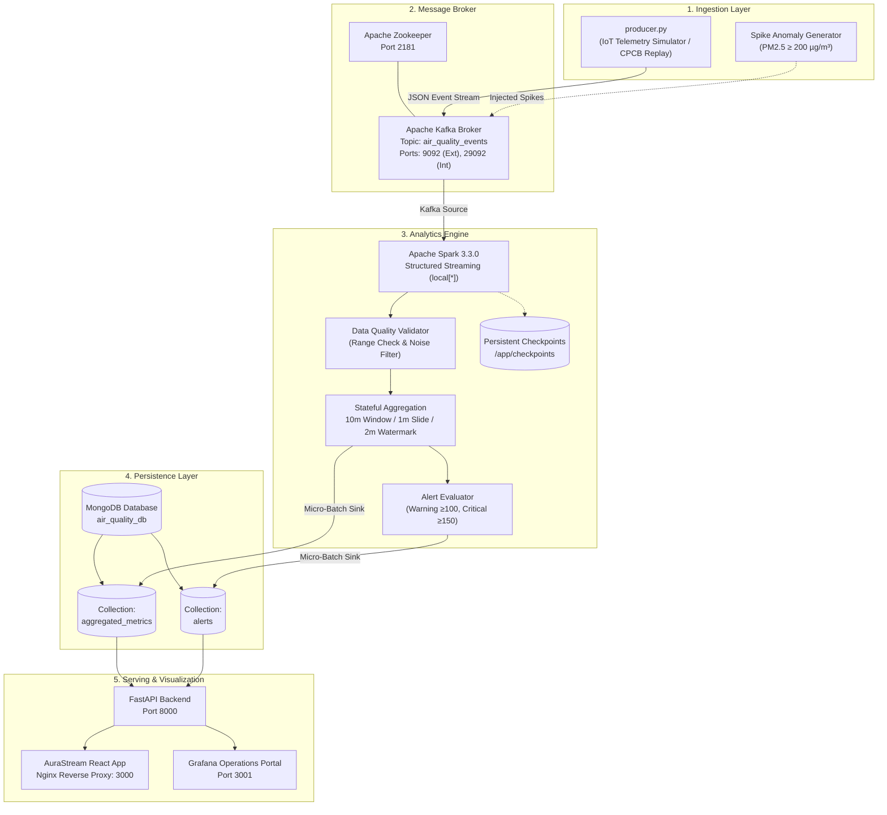
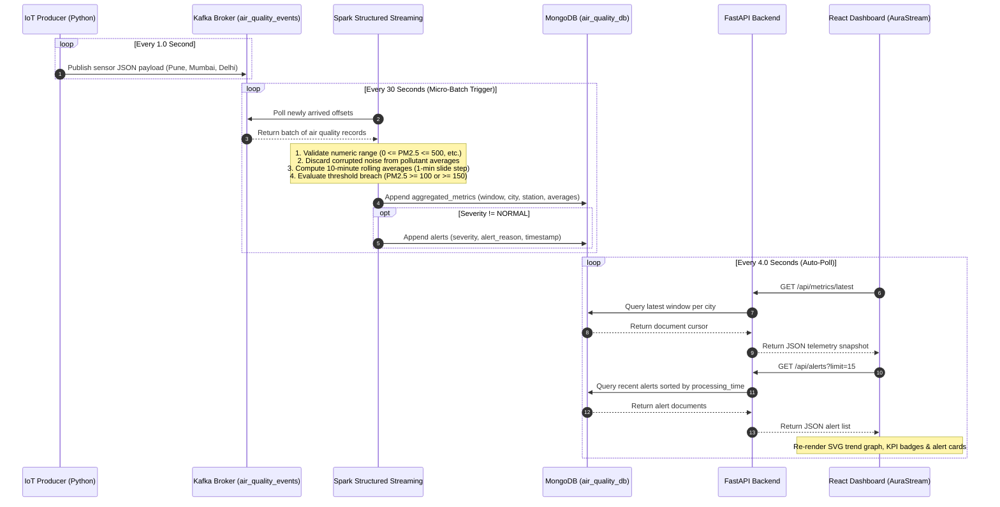
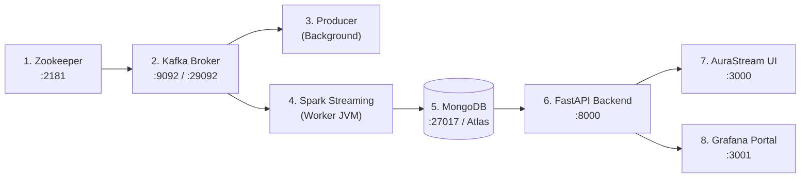

# AuraStream: Real-Time IoT Air Quality Streaming & Analytics

[](https://www.python.org/)
[-231F20?logo=apachekafka&logoColor=white)](https://kafka.apache.org/)
[](https://spark.apache.org/)
[](https://www.mongodb.com/)
[](https://fastapi.tiangolo.com/)
[](https://react.dev/)
[](https://grafana.com/)
[](https://www.docker.com/)
[](ATTRIBUTION.md)

> **Real-time distributed IoT telemetry streaming pipeline, stream analytics engine, and multi-tier visualization system engineered for high-frequency urban air quality monitoring and automated threshold breach alerting.**

---

## 1. Project Overview

Municipal environmental monitoring infrastructure requires immediate detection of dangerous airborne pollutant spikes (PM2.5, PM10, NO₂, SO₂, CO) to trigger early warning systems and protect public health. Traditional batch ingestion and periodic reporting pipelines introduce latency on the order of hours, leaving citizens and environmental authorities vulnerable during sudden toxic particulate spikes.

**AuraStream** resolves this latency barrier through an end-to-end distributed stream processing architecture:
1. **IoT Telemetry Ingestion:** Continuous high-throughput sensor telemetry generation and replay based on Central Pollution Control Board (CPCB) standards for major Indian metropolitan zones (Pune, Mumbai, Delhi).
2. **Distributed Message Streaming:** Decoupled event ingestion via **Apache Kafka** handling partitioned sensor topics (`air_quality_events`) with strict delivery acknowledgment.
3. **Structured Stream Analytics:** **Apache Spark Structured Streaming** executing stateful 10-minute rolling window aggregations, 2-minute late-arrival watermarking, invalid sensor value filtering, and automated two-tier alert evaluation.
4. **Persistent Multi-Model Storage:** Micro-batch streaming sinks persisting aggregated window metrics and threshold alerts to **MongoDB** (supporting both MongoDB Atlas and containerized/local deployments).
5. **Multi-Tier Visual Presentation:** High-performance **FastAPI** backend serving real-time analytics to a responsive **AuraStream React Dashboard** and a pre-provisioned **Grafana 10.2 Operations Center**.

The complete multi-container architecture is engineered and resource-constrained to run stably on developer machines with **8 GB RAM** without exhausting memory.

---

## 2. Key Features

### Implemented & Verified Capabilities
- **Continuous Telemetry Producer (`producer.py`):**
  - Replays normalized CPCB air-quality metrics across 3 major metropolitan hubs: Pune, Mumbai, and Delhi.
  - Built-in fallback synthetic IoT sensor generator when physical CSV files are unmounted.
  - Configurable emission intervals (`PRODUCER_INTERVAL=1.0s`), city filters, randomized seed generation, and controlled spike injection scenarios (`ENABLE_TEST_SPIKES`).
- **Distributed Event Ingestion (Kafka + Zookeeper):**
  - Partitioned message broker on topic `air_quality_events` with dual listener configuration (`kafka:29092` internal container network, `localhost:9092` external host).
  - Explicit payload serialization enforcing timestamps, city keys, station IDs, and 5 pollutant channels.
- **Spark Structured Streaming Engine (`spark_streaming_job.py`):**
  - Reads directly from Kafka stream starting at latest offsets.
  - Stateful 10-minute sliding window aggregations with 1-minute slide intervals.
  - 2-minute event watermark handling out-of-order or delayed sensor readings.
  - Strict numeric range validation rule: out-of-range sensor noise (e.g. negative readings, values > 500/600) is filtered out of mathematical pollutant averages while recorded in data validity ratios (`valid_rate`).
  - Automated alert generation: evaluates both rolling window averages and peak values against CPCB severity thresholds (`WARNING` at $\ge 100\ \mu\text{g/m}^3$, `CRITICAL` at $\ge 150\ \mu\text{g/m}^3$).
  - Micro-batch streaming writes (`foreachBatch`) to MongoDB collections `aggregated_metrics` and `alerts` with persistent volume-backed checkpoints.
- **FastAPI REST Backend (`dashboard/backend/app.py`):**
  - High-concurrency async endpoints for system health (`/api/health`), active stations (`/api/stations`), latest window snapshots (`/api/metrics/latest`), historical trend curves (`/api/metrics/history`), alerts log (`/api/alerts`), and aggregated pipeline telemetry (`/api/stats`).
  - Dynamic fallback data virtualization ensuring complete, visual dashboard states even during initial stream bootstrapping.
  - Safe MongoDB URI masking preventing credential exposure in public responses.
- **AuraStream React Dashboard (`dashboard/frontend`):**
  - Modern dark-mode UI built with React 18, Vite, and Nginx reverse proxy.
  - Dynamic KPI cards displaying Data Validation Rate, Critical Spike Count, Active Stations, and Aggregation Window.
  - Interactive city selection (Pune, Mumbai, Delhi) with live AQI status badges (Good, Moderate, Unhealthy for Sensitive, Unhealthy, Hazardous).
  - SVG historical rolling trend graph with dynamic coordinates and warning/critical threshold indicators.
  - Real-time Spark alert feed showing rule violations, average/maximum PM2.5 readings, and timestamps.
- **Grafana 10.2 Operations Center:**
  - Automated file-based provisioning for datasources and pre-configured dashboards.
  - Validity gauge, Chicago/city target PM2.5 metric stats, critical alert count, station counters, rolling time series graph, and alert event table.

---

## 3. Application Screenshots

### Main Dashboard Overview
The primary AuraStream interface displaying overall system health, top-tier KPI metrics, real-time urban telemetry cards, historical trend charts, and the live Spark alerts feed.


### Air Quality Overview & Sensor Cards
Detailed view of urban sensor nodes (Pune, Mumbai, Delhi) showing real-time 10-minute rolling averages for PM2.5, PM10, NO₂, SO₂, and CO along with CPCB-aligned AQI health classifications.


### Pollutant-Specific Telemetry
Focused breakdown of pollutant parameters across monitoring stations, distinguishing between normal baseline readings and elevated particulate spikes.


### Historical Trend Analytics & Alerts Feed
Visualizing 10-minute micro-batch sliding window PM2.5 trends against critical ($150\ \mu\text{g/m}^3$) and warning ($100\ \mu\text{g/m}^3$) threshold lines, paired with real-time alert logs.


### Grafana 10.2 Operational Monitoring
Grafana dashboard pre-provisioned via JSON specifications, tracking data validity percentages, target PM2.5 readings, alert frequencies, and time-series rolling trends.


### Verified Pipeline Architecture
Visual representation of the end-to-end data processing lifecycle from IoT sensor simulation to multi-dashboard presentation.


---

## 4. System Architecture

The following Mermaid diagrams illustrate the verified architecture, data lifecycle, and inter-service communications.

### 4.1 Overall System Architecture



### 4.2 Real-Time Data Processing Sequence



---

## 5. Technology Stack

| Domain | Technology | Version | Purpose |
| :--- | :--- | :--- | :--- |
| **Telemetry Ingestion** | Python / `kafka-python` | `3.10` / `2.0.2` | Ingests real-time synthetic and historical CPCB sensor telemetry |
| **Stream Broker** | Apache Kafka (Confluent cp-kafka) | `7.3.0` (Kafka `3.3.0`) | High-throughput distributed topic queue for sensor events |
| **Cluster Coordination** | Apache Zookeeper | `7.3.0` | Kafka broker metadata management and cluster state tracking |
| **Stream Processing** | Apache Spark Structured Streaming | `3.3.0-hadoop3.3` | Stateful micro-batch sliding window analytics and validation |
| **Kafka Spark Connector** | `spark-sql-kafka-0-10_2.12` | `3.3.0` | Native streaming consumer connecting Spark to Kafka topic |
| **Mongo Spark Connector** | `mongo-spark-connector_2.12` | `10.1.1` | Native write sink persisting micro-batches to MongoDB collections |
| **Persistence Database** | MongoDB / MongoDB Atlas | `7.0` | Document database storing aggregated metrics and alerts |
| **Backend REST API** | FastAPI / Uvicorn | `0.110.0` / `0.28.0` | Asynchronous REST service serving analytics to frontends |
| **Database Driver** | PyMongo | `4.6.1` | Thread-safe MongoDB client for FastAPI backend |
| **Frontend Framework** | React / Vite | `18.2.0` / `5.4.21` | Modern reactive UI for live air quality telemetry and graphs |
| **Frontend Web Server** | Nginx Alpine | `latest` | Serves production build and reverse-proxies `/api/` to backend |
| **Operational Monitoring**| Grafana | `10.2.2` | Pre-provisioned metrics dashboard, threshold gauges and tables |
| **Orchestration** | Docker & Docker Compose | `v2+` | Single-command multi-container lifecycle with memory limits |

---

## 6. System Workflow & Data Pipeline

1. **Generation & Extraction:**
   - The producer script (`producer.py`) continuously iterates over target cities (`Pune`, `Mumbai`, `Delhi`).
   - If `data/cpcb_indian_air_quality.csv` is present, it replays normalized historical CPCB readings. If absent, the robust synthetic generator takes over automatically, producing realistic stochastic variations across 5 major air quality channels.
2. **Publishing to Kafka:**
   - Events are published as UTF-8 encoded JSON strings to the `air_quality_events` Kafka topic.
   - Message keys are keyed by city name (`Pune`, `Mumbai`, `Delhi`) to preserve partition affinity and ordering.
3. **Stream Ingestion in Spark:**
   - The Spark driver connects to `kafka:29092` with `startingOffsets: "latest"`.
   - The raw binary payload is parsed into typed columns using a defined `SCHEMA`.
   - Unix epoch timestamps are converted to Spark `TimestampType` with a 2-minute watermark (`withWatermark("event_timestamp", "2 minutes")`).
4. **Data Cleansing & Validation:**
   - Numeric range checks ensure validity:
     $$\text{is\_valid} = (0 \le \text{PM2.5} \le 500) \land (0 \le \text{PM10} \le 600) \land (0 \le \text{NO}_2 \le 400) \land (0 \le \text{SO}_2 \le 100) \land (0 \le \text{CO} \le 50)$$
   - Out-of-bounds readings are filtered out of mathematical pollutant averages (`avg_pm25`, `avg_pm10`, etc.) while valid vs. total counts are logged to track `valid_rate`.
5. **Window Aggregation:**
   - Records are grouped by `window(event_timestamp, "10 minutes", "1 minute")`, `city`, `station_name`, and `station_id`.
   - Metrics computed: `avg_pm25`, `avg_pm10`, `avg_no2`, `avg_so2`, `avg_co`, `max_pm25`, `valid_count`, `total_count`, and `valid_rate`.
6. **Threshold Alert Classification:**
   - Micro-batches evaluate rolling PM2.5 severity:
     - **CRITICAL:** `avg_pm25 >= 150` or `max_pm25 >= 150` $\rightarrow$ Severity: `CRITICAL`
     - **WARNING:** `avg_pm25 >= 100` or `max_pm25 >= 100` $\rightarrow$ Severity: `WARNING`
     - Otherwise: Severity `NORMAL` (excluded from alerts collection).
7. **Storage Sinks:**
   - Every 30 seconds, Spark writes micro-batches to MongoDB using `org.mongodb.spark:mongo-spark-connector_2.12:10.1.1` in `append` mode.
   - State checkpoints are saved to `/app/checkpoints/aggregates` and `/app/checkpoints/alerts`.
8. **Visualization & Polling:**
   - AuraStream React UI polls `/api/metrics/latest`, `/api/metrics/history`, and `/api/alerts` every 4 seconds.
   - Grafana continuously queries the backend API datasource on port 3001.

---

## 7. Apache Kafka Implementation

### Topics and Configuration
- **Topic Name:** `air_quality_events`
- **Partitions:** 1 (configurable)
- **Replication Factor:** 1
- **Retention:** Default broker retention

### Dual Listener Architecture
- **Internal Listener:** `INTERNAL://kafka:29092` (used by Docker container services: Spark and Producer).
- **External Listener:** `EXTERNAL://localhost:9092` (used by host-based development scripts and diagnostics).

### Message Payload Schema
```json
{
  "station_id": "synthetic_pune",
  "station_name": "Pune Central Station",
  "city": "Pune",
  "state": "Maharashtra",
  "timestamp": 1794158565,
  "source_timestamp": "2026-11-08T17:22:45Z",
  "pm25": 81.46,
  "pm10": 116.54,
  "no2": 28.50,
  "so2": 14.65,
  "co": 2.28,
  "data_source": "synthetic_generator",
  "is_synthetic": true,
  "scenario_id": "synthetic_test"
}
```

---

## 8. Apache Spark Structured Streaming

### Processing Parameters
- **Execution Mode:** `local[*]` (multi-threaded single JVM within the container to fit 8 GB RAM machines).
- **Trigger Interval:** `processingTime="30 seconds"`.
- **Watermark Delay:** `2 minutes` on `event_timestamp`.
- **Window Duration:** `10 minutes` sliding every `1 minute`.

### Data Cleansing Formula
Invalid sensor telemetry (e.g. electrical noise or disconnected probes) is isolated so it does not distort regional environmental indices:
```python
avg(when(col("is_valid") & col("pm25").isNotNull(), col("pm25"))).alias("avg_pm25")
```

### Checkpointing
Fault tolerance is guaranteed across container restarts through persistent Docker volumes:
- Volume: `spark-checkpoints` $\rightarrow$ Mounted at `/app/checkpoints`
- Aggregates Checkpoint: `/app/checkpoints/aggregates`
- Alerts Checkpoint: `/app/checkpoints/alerts`

---

## 9. Air Quality Analytics & Classifications

The system monitors 5 primary environmental pollutant indicators:

| Pollutant | Symbol | Normal Range | Out-of-Bounds Check | Alert Trigger | Unit |
| :--- | :---: | :---: | :---: | :---: | :---: |
| **Fine Particulate Matter** | $\text{PM}_{2.5}$ | $0 - 60$ | $> 500$ or $< 0$ | $\ge 100$ (Warn), $\ge 150$ (Crit) | $\mu\text{g/m}^3$ |
| **Coarse Particulate Matter** | $\text{PM}_{10}$ | $0 - 100$ | $> 600$ or $< 0$ | Secondary tracking | $\mu\text{g/m}^3$ |
| **Nitrogen Dioxide** | $\text{NO}_2$ | $0 - 80$ | $> 400$ or $< 0$ | Secondary tracking | $\mu\text{g/m}^3$ |
| **Sulphur Dioxide** | $\text{SO}_2$ | $0 - 80$ | $> 100$ or $< 0$ | Secondary tracking | $\mu\text{g/m}^3$ |
| **Carbon Monoxide** | $\text{CO}$ | $0 - 4.0$ | $> 50$ or $< 0$ | Secondary tracking | $\text{mg/m}^3$ |

### Air Quality Index (AQI) Categorization Rules
- **Good:** $\text{PM}_{2.5} \le 12.0\ \mu\text{g/m}^3$ (Green)
- **Moderate:** $12.0 < \text{PM}_{2.5} \le 35.4\ \mu\text{g/m}^3$ (Yellow)
- **Unhealthy for Sensitive Groups:** $35.4 < \text{PM}_{2.5} \le 55.4\ \mu\text{g/m}^3$ (Orange)
- **Unhealthy:** $55.4 < \text{PM}_{2.5} \le 150.0\ \mu\text{g/m}^3$ (Red)
- **Hazardous:** $\text{PM}_{2.5} > 150.0\ \mu\text{g/m}^3$ (Purple)

---

## 10. Grafana Operations Center

Grafana is provisioned via configuration files mounted directly into the container:

- **Datasource Provisioning (`grafana/provisioning/datasources/datasource.yml`):**
  - Name: `DashboardAPI`
  - URL: `http://dashboard-backend:8000`
- **Dashboard Provisioning (`grafana/provisioning/dashboards/dashboard.yml`):**
  - Path: `/etc/grafana/provisioning/dashboards/json`
- **Dashboard Specification (`grafana/dashboards/air_quality.json`):**
  - UID: `air-quality-iot-main`
  - Title: *IoT Air Quality Real-Time Monitoring*
  - Refresh Rate: 5 seconds auto-refresh
  - Panels:
    1. Pipeline Information (HTML banner)
    2. Spark Data Validity Rate (Gauge, thresholds: 90% orange, 95% green)
    3. Target PM2.5 Stat Panel
    4. Active Critical Alerts Counter
    5. Monitored Urban Stations Counter
    6. 10-Minute Rolling Average PM2.5 By City (Timeseries graph)
    7. Recent Air Quality Threshold Alerts Table

---

## 11. Project Directory Structure

```plaintext
Real-time-air-quality-monitoring-dashboard/
├── .env.example                     # Environment template for local/Atlas credentials
├── .gitignore                       # Git exclusion rules (ignores .env, checkpoints, logs)
├── ATTRIBUTION.md                   # Academic provenance & licensing declaration
├── analysis_notebook.ipynb          # Jupyter exploratory data analysis notebook
├── docker-compose.yml               # Multi-container orchestration specification
├── Dockerfile.producer              # Docker build file for Kafka telemetry producer
├── producer.py                      # IoT air quality generator and Kafka publisher
├── spark_streaming_job.py           # Spark Structured Streaming pipeline script
├── requirements.txt                 # Host Python development dependencies
├── SmartCityAirQualityPresentation.pdf # Project presentation deck
├── dashboard/
│   ├── backend/
│   │   ├── app.py                   # FastAPI REST backend application
│   │   ├── Dockerfile               # Backend container specification
│   │   └── requirements.txt         # FastAPI, Uvicorn, PyMongo dependencies
│   └── frontend/
│       ├── Dockerfile               # Multi-stage Node build & Nginx runtime
│       ├── index.html               # React HTML root entrypoint
│       ├── nginx.conf               # Nginx reverse proxy configuration (/api/ -> backend)
│       ├── package.json             # React 18, Vite dependencies & build scripts
│       ├── vite.config.js           # Vite development and build settings
│       └── src/
│           ├── App.jsx              # AuraStream dashboard core application component
│           ├── index.css            # Custom CSS styling (dark glassmorphism theme)
│           └── main.jsx             # React DOM root render mount
├── docs/
│   └── screenshots/                 # Genuine live application captures
│       ├── air-quality-overview.png
│       ├── grafana-dashboard.png
│       ├── historical-trends.png
│       ├── main-dashboard.png
│       ├── pollutant-analysis.png
│       └── system-architecture.png
├── grafana/
│   ├── dashboards/
│   │   └── air_quality.json         # Pre-configured Grafana monitoring dashboard
│   └── provisioning/
│       ├── dashboards/
│       │   └── dashboard.yml        # Automatic dashboard loader configuration
│       └── datasources/
│           └── datasource.yml       # Automatic datasource provider configuration
└── tests/
    └── test_pipeline_logic.py       # Unit test suite verifying thresholds & calculations
```

---

## 12. Prerequisites & Hardware Budget

### Hardware Constraints
This project is engineered to execute on standard development laptops:
- **Processor:** Intel Core i5/i7 (or equivalent multi-core x86_64/ARM64)
- **RAM:** Minimum 8 GB physical memory (~2.8 GB total allocated container limit)
- **Storage:** 15 GB free disk space (Docker images, Ivy packages, checkpoint caches)

### Software Requirements
- **Docker Desktop** (version 24.0+ or Docker Engine 20.10+) with WSL2 backend on Windows or native Linux daemon.
- **Docker Compose** (version 2.20+).
- **Web Browser** (Google Chrome, Microsoft Edge, Mozilla Firefox, or Brave).
- *(Optional)* Python 3.10+ for running standalone host producer scripts or tests.

---

## 13. Running the Complete Application

The entire platform can be brought up with Docker Compose.

### Step 1: Clone the Repository
```bash
git clone https://github.com/Antariksh62/Real-time-air-quality-monitoring-dashboard.git
cd Real-time-air-quality-monitoring-dashboard
```

### Step 2: Configure Environment Variables
Copy the sample environment file:
```bash
cp .env.example .env
```
By default, the pipeline connects to MongoDB on `mongodb://host.docker.internal:27017/` (or your MongoDB Atlas connection string).

### Step 3: Build and Launch All Services
```bash
docker compose up -d --build
```

### Service Startup Sequence & Port Map



| Service Container | Internal Port | Host Port | Purpose | Verification URL |
| :--- | :---: | :---: | :--- | :--- |
| **`zookeeper`** | 2181 | `2181` | Cluster coordination | `localhost:2181` |
| **`kafka`** | 29092 | `9092` | Event broker | `localhost:9092` |
| **`producer`** | — | — | Sensor telemetry generation | Container stdout logs |
| **`spark-streaming-app`** | — | — | Structured streaming worker | Container stdout logs |
| **`dashboard-backend`** | 8000 | `8000` | REST API service | [http://localhost:8000/api/health](http://localhost:8000/api/health) |
| **`dashboard-frontend`**| 80 | `3000` | AuraStream React interface | [http://localhost:3000](http://localhost:3000) |
| **`grafana`** | 3000 | `3001` | Grafana operations portal | [http://localhost:3001](http://localhost:3001) |

---

## 14. Environment Configuration

All configurable environment variables are documented below:

| Variable | Default Value | Description |
| :--- | :--- | :--- |
| `MONGODB_URI` | `mongodb://localhost:27017/` | Connection URI for MongoDB Atlas or local MongoDB instance |
| `MONGODB_DATABASE` | `air_quality_db` | Target MongoDB database name |
| `MONGO_COLLECTION` | `aggregated_metrics` | Collection receiving 10-minute sliding window aggregates |
| `ALERTS_COLLECTION`| `alerts` | Collection receiving triggered threshold breaches |
| `KAFKA_BOOTSTRAP` | `kafka:29092` | Bootstrap broker host:port address |
| `KAFKA_TOPIC` | `air_quality_events` | Kafka topic name for air quality telemetry |
| `PRODUCER_INTERVAL`| `1.0` | Emission delay (seconds) between city batches |
| `FILTER_CITIES` | `Pune,Mumbai,Delhi` | Comma-delimited list of active metropolitan targets |
| `ENABLE_TEST_SPIKES`| `false` | Enable automated artificial spike injection for alert testing |
| `SPIKE_CITY` | `Pune` | Target city for intentional critical spike injection |
| `SPIKE_DELAY` | `45` | Seconds after startup before injecting first spike |
| `SPIKE_DURATION` | `60` | Duration (seconds) of the elevated spike event |

> [!IMPORTANT]
> Never commit your production `.env` file to version control. The repository's `.gitignore` explicitly excludes `.env` to protect your credentials.

---

## 15. API Documentation

The FastAPI backend exposes clean, JSON-serialized endpoints:

### 1. Health & Connection Status
- **Endpoint:** `GET /api/health`
- **Response:**
  ```json
  {
    "status": "healthy",
    "mongo_connected": true,
    "details": {
      "target": "MongoDB Local/Container",
      "database": "air_quality_db",
      "metrics_count": 48,
      "alerts_count": 4
    },
    "timestamp": "2026-11-08T17:28:04.689750+00:00"
  }
  ```

### 2. Available Monitoring Stations
- **Endpoint:** `GET /api/stations?city=Pune`
- **Response:**
  ```json
  {
    "stations": [
      "Revenue Colony-Shivajinagar, Pune - IITM",
      "Hadapsar, Pune - IITM",
      "Karve Road, Pune - MPCB",
      "Katraj Dairy, Pune - MPCB"
    ],
    "count": 4
  }
  ```

### 3. Latest Window Metrics
- **Endpoint:** `GET /api/metrics/latest`
- **Response:**
  ```json
  {
    "data": {
      "Pune": {
        "city": "Pune",
        "station_name": "Revenue Colony-Shivajinagar, Pune - IITM",
        "window": {
          "start": "2026-11-08T17:20:00Z",
          "end": "2026-11-08T17:30:00Z"
        },
        "avg_pm25": 52.9,
        "avg_pm10": 97.0,
        "avg_no2": 29.5,
        "avg_so2": 10.2,
        "avg_co": 1.5,
        "max_pm25": 68.2,
        "valid_count": 59,
        "total_count": 60,
        "valid_rate": 0.9833,
        "data_source": "CPCB historical dataset"
      }
    },
    "count": 3
  }
  ```

### 4. Historical Trend Series
- **Endpoint:** `GET /api/metrics/history?city=Pune&limit=25`
- **Response:** Array of chronological window objects for plotting timeseries trends.

### 5. Triggered Alerts
- **Endpoint:** `GET /api/alerts?limit=15`
- **Response:**
  ```json
  {
    "data": [
      {
        "city": "Delhi",
        "station_name": "Anand Vihar, Delhi - DPCC",
        "severity": "CRITICAL",
        "alert_reason": "avg_pm25>=150 and max_pm25>=150 (Severe)",
        "avg_pm25": 218.4,
        "max_pm25": 248.9,
        "processing_time": "2026-11-08T17:28:13Z"
      }
    ],
    "count": 1
  }
  ```

### 6. Pipeline Quality Stats
- **Endpoint:** `GET /api/stats`
- **Response:** Validation ratios, total window counts, and alert distribution.

---

## 16. Docker Configuration & Resource Management

To prevent out-of-memory (OOM) faults on 8 GB RAM machines, every service is configured with explicit container memory ceilings in `docker-compose.yml`:

```yaml
services:
  zookeeper:          # Memory Limit: 384M (JVM -Xmx256m)
  kafka:              # Memory Limit: 768M (JVM -Xmx512m)
  spark:              # Memory Limit: 1200M (local[*] execution mode)
  producer:           # Memory Limit: 128M
  dashboard-backend:  # Memory Limit: 192M
  dashboard-frontend: # Memory Limit: 96M
  grafana:            # Memory Limit: 256M
```
**Total Allocated Footprint:** ~3.0 GB across all 7 containers, leaving ample host memory for the operating system and Docker engine.

---

## 17. Testing & Verification

The repository includes a dedicated test suite verifying all pipeline calculations and alert rules.

### Running Unit Tests
```bash
python -m unittest discover tests
```

### Verified Test Matrix
```plaintext
test_alert_reason_alignment (tests.test_pipeline_logic.TestAirQualityLogic) ... ok
test_alert_severity_thresholds (tests.test_pipeline_logic.TestAirQualityLogic) ... ok
test_invalid_record_exclusion (tests.test_pipeline_logic.TestAirQualityLogic) ... ok
test_spike_data_generator (tests.test_pipeline_logic.TestAirQualityLogic) ... ok
test_validation_rules (tests.test_pipeline_logic.TestAirQualityLogic) ... ok

----------------------------------------------------------------------
Ran 5 tests in 0.015s

OK
```

### Live End-to-End Pipeline Verification Commands
- **Check Kafka Topic Messages:**
  ```bash
  docker exec kafka kafka-console-consumer --bootstrap-server kafka:29092 --topic air_quality_events --from-beginning --max-messages 3
  ```
- **Check Spark Micro-Batch Execution Logs:**
  ```bash
  docker logs spark-streaming-app --tail 25
  ```
- **Verify Backend Connection to MongoDB:**
  ```bash
  curl http://localhost:8000/api/health
  ```
- **Verify Grafana Dashboard Provisioning:**
  ```bash
  curl http://localhost:3001/api/dashboards/uid/air-quality-iot-main
  ```

---

## 18. Troubleshooting

### 1. Docker Containers Fail to Start or Exit Immediately
- **Cause:** Docker Desktop RAM limit exceeded.
- **Fix:** In Docker Desktop $\rightarrow$ Settings $\rightarrow$ Resources, ensure memory allocation is set to at least 4.0 GB.

### 2. Kafka Connection Timeout (`NoBrokersAvailable`)
- **Cause:** Kafka broker takes 10–15 seconds to finish metadata registration with Zookeeper.
- **Fix:** The producer includes automated retry loops (`retries=5`). If launching manually, wait for `[KafkaServer id=1] started` in `docker logs kafka`.

### 3. Spark Micro-Batch Latency
- **Cause:** Initial batch downloads Maven dependencies (`spark-sql-kafka`, `mongo-spark-connector`).
- **Fix:** Allow 60–90 seconds during the first launch. Subsequent micro-batches run from the local Ivy cache within milliseconds.

### 4. Port 27017 Conflict on Host
- **Cause:** A native MongoDB service is already running on the host machine.
- **Fix:** The project utilizes `mongodb://host.docker.internal:27017/` in `.env` to seamlessly leverage your existing host database without starting a redundant container.

### 5. Grafana Shows Login Screen
- **Fix:** Anonymous viewer mode is enabled in `docker-compose.yml` (`GF_AUTH_ANONYMOUS_ENABLED=true`). Alternatively, log in using default credentials: `admin` / `admin`.

---

## 19. Future Improvements

- [ ] **Multi-Broker Kafka Cluster:** Expand from single-node broker to a 3-broker cluster with partition replication factor 2.
- [ ] **Predictive Machine Learning:** Train an LSTM or Prophet model on historical CPCB seasonal patterns to forecast AQI trends 6 hours in advance.
- [ ] **Geospatial Map Visualization:** Integrate Leaflet/Mapbox in the React dashboard for live geospatial heatmaps across Indian cities.
- [ ] **Automated Webhook & SMS Alerts:** Connect Twilio or Telegram Bot webhooks when `CRITICAL` spike conditions persist for > 3 consecutive windows.
- [ ] **Kubernetes Deployment:** Provide Helm charts and K8s manifests for deploying the pipeline onto AWS EKS or GCP GKE.

---

## 20. Contributors & Attribution

- **Lead Engineer & Maintainer:** **Sumit Arya** ([@Antariksh62](https://github.com/Antariksh62)) — Architecture overhaul, Spark streaming optimization, React AuraStream dashboard development, Grafana provisioning, and complete pipeline containerization.
- **Academic Attribution:** Based on research concepts originally explored by `sucharitha1812` (`sucharithag18/real-time-iot-air-quality-pipeline`). For full provenance, defect resolutions, and modifications, refer to [ATTRIBUTION.md](ATTRIBUTION.md).

---

## 21. License

This project is open-source and distributed under the **MIT License**. See [ATTRIBUTION.md](ATTRIBUTION.md) for full licensing terms.
