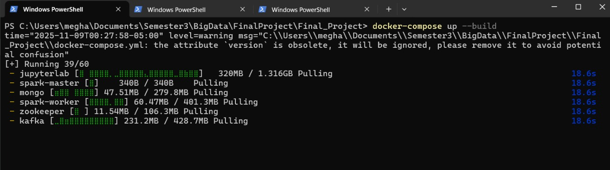
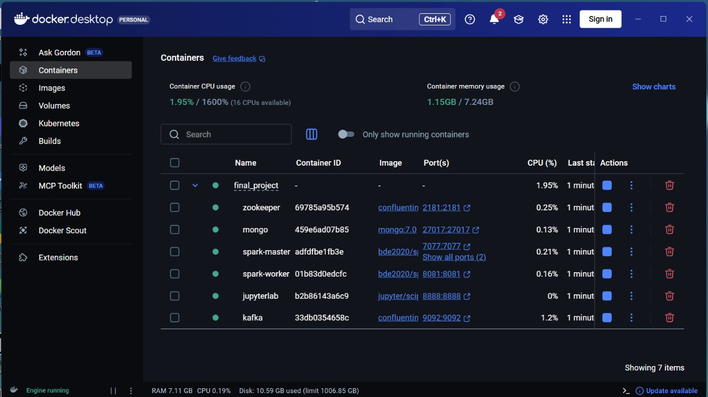
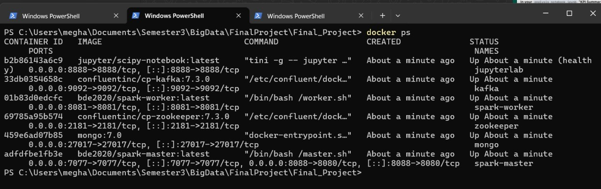
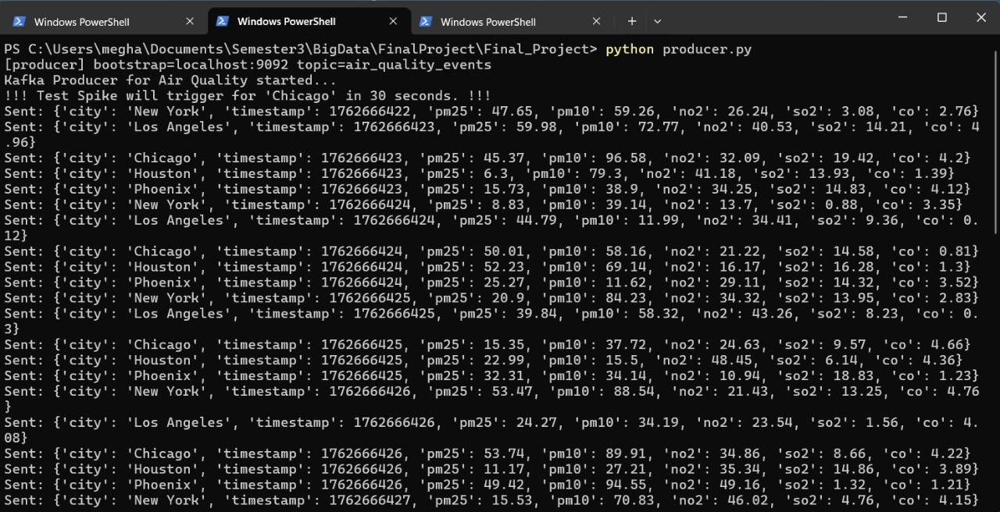
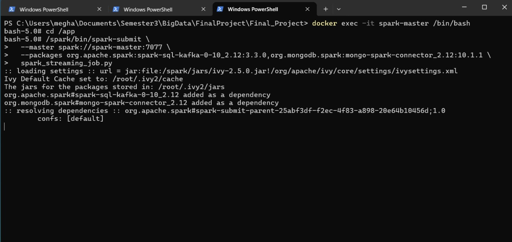
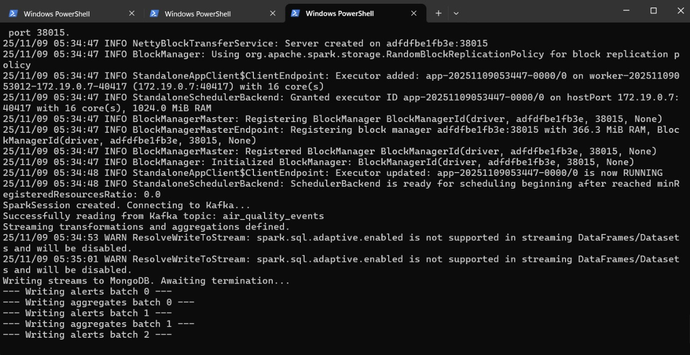
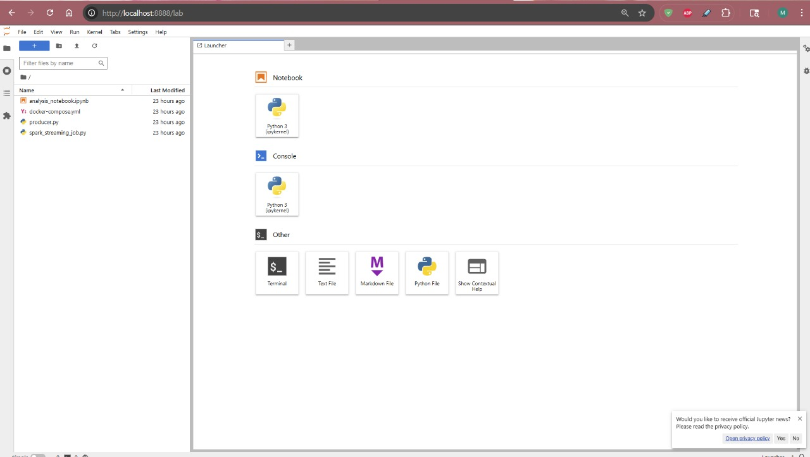
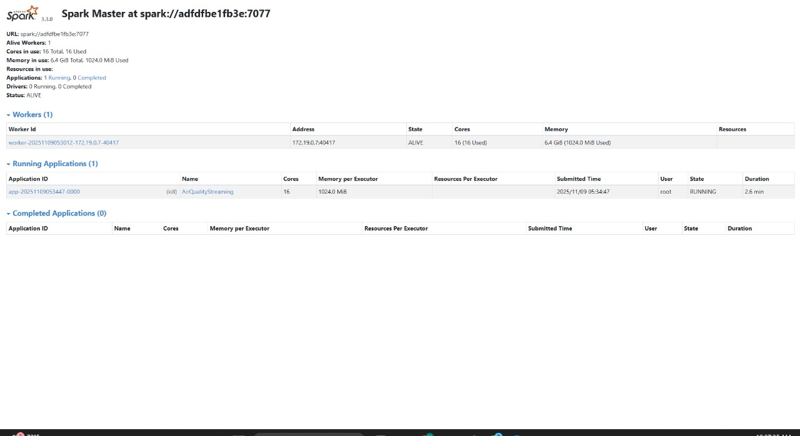

# Smart City Air Quality Monitoring & Real-Time Alerting Pipeline


> [!NOTE]
> **Academic Simulation Notice:** This project operates on synthetic IoT sensor streams designed to evaluate distributed stream processing, data validation, and real-time alert architectures. All pollutant data is simulated for research and demonstration purposes.

---

## Overview

This project implements a **real-time distributed data pipeline** for monitoring and analyzing air quality across multiple cities. Using simulated IoT sensor data streams, the system ingests air pollutant readings (PM2.5, PM10, NO₂, SO₂, CO) via **Apache Kafka**, processes the data with **Apache Spark Structured Streaming**, stores aggregated metrics in **MongoDB**, and visualizes insights in real time via an **AuraStream React Dashboard** and **Grafana**.

**Problem Statement:** City environmental departments need to detect and respond to dangerous air-pollution spikes within minutes rather than hours. Traditional batch systems delay insights.  

**Goal:** Demonstrate how modern streaming frameworks enable smart cities to detect pollution spikes instantly, isolate invalid sensor telemetry, and broadcast early warning alerts.

**Technology Stack:**
- **Apache Kafka (Confluent cp-kafka 7.3.0 / Kafka 3.3)** – Real-time event broker for ingesting continuous air quality readings.
- **Apache Spark Structured Streaming (v3.3.0)** – Performs 10-minute rolling window aggregations (1-minute slide), data validation, and threshold alerting.
- **MongoDB (v7.0)** – Document database storing aggregated window metrics and alerts.
- **AuraStream React Dashboard** – Responsive real-time monitoring interface with AQI categorizations, live time-series charts, and alert feeds.
- **Grafana (v10.2.2)** – Provisioned operations dashboard displaying system gauges, alerts, and time-series panels.
- **FastAPI Backend** – High-performance REST service providing live data endpoints to dashboards.
- **Docker Compose (v2.24+)** – Single-command orchestration optimized for 8 GB RAM developer laptops.

---

## Verified Pipeline Metrics & Performance

- **Streaming Throughput:** 5 urban sensor nodes emitting every 1.0 second = **~300 events/minute** (5 events/sec).
- **Processing Trigger:** Micro-batch interval of **30 seconds** with a 2-minute late-arrival watermark.
- **Rolling Window:** 10-minute aggregation window sliding every 1 minute.
- **Data Quality Filtering:** Out-of-bounds readings (`is_valid = false`) are automatically excluded from pollutant averages while tracked in `valid_rate`.
- **Resource Footprint:** Engineered to run smoothly on machines with **8 GB physical RAM** (~2.3 GB total container footprint).

---

## Quick Start (One Command)

```bash
# 1. Start all streaming services, dashboards, and automated producer
docker compose up --build
```

### Accessing the Dashboards:
- **AuraStream React Dashboard:** [http://localhost:3000](http://localhost:3000)
- **Grafana Pipeline Monitor:** [http://localhost:3001](http://localhost:3001) *(User: `admin` / Password: `admin`)*
- **FastAPI Backend Docs:** [http://localhost:8000/docs](http://localhost:8000/docs)
- **MongoDB:** `localhost:27017`

### Optional Offline Analysis (JupyterLab):
To launch JupyterLab without overloading RAM during streaming:
```bash
docker compose --profile analysis up jupyterlab
# Accessible at http://localhost:8888/lab (Password: test)
```

**System Requirements:**
- Docker Engine 20.10+
- Docker Compose 2.0+
- Minimum 8GB RAM
- 20GB available disk space

### Ports Configuration
The following ports are configured in the `docker-compose.yml` file to enable seamless communication among services while avoiding common conflicts:

- **Zookeeper – `2181:2181`**  
  Standard port used by Kafka for cluster coordination.

- **Kafka – `9092:9092` (external), `29092` (internal)**  
  Port `9092` is exposed for external communication with the `producer.py` script, while Spark connects internally using `kafka:29092`. This dual mapping ensures reliable message flow within and outside the Docker network.

- **MongoDB – `27017:27017`**  
  Default MongoDB port for data storage and retrieval.

- **Spark Master – `8088:8080`**  
  Local port `8088` maps to the container’s `8080`, preventing conflicts with other services that typically use port 8080.

- **Spark Worker – `8081:8081`**  
  Standard configuration for Spark Worker UI monitoring.

- **JupyterLab – `8888:8888`**  
  Used for interactive analytics and visualization in the browser.  
  Accessible at: [http://localhost:8888/lab](http://localhost:8888/lab) (Password: `test`)

---

## Quick Start (TL;DR)

```bash
# Start infrastructure
docker compose up --build

# Run Kafka producer
python producer.py

# Submit Spark job
docker exec -it spark-master /bin/bash
cd /app
/spark/bin/spark-submit \
--master spark://spark-master:7077 \
--packages org.apache.spark:spark-sql-kafka-0-10_2.12:3.3.0,org.mongodb.spark:mongo-spark-connector_2.12:10.1.1 \
spark_streaming_job.py
```

## Setup Instructions

This project requires three separate terminal windows to run.

### Terminal 1: Start the Infrastructure
In your project directory, start all Docker services.

```bash
docker compose up --build
```

Wait until you see this message in the Kafka logs:
```
[KafkaServer id=1] started
```

### Docker Compose Initialization
Docker Compose successfully builds and starts all required services — JupyterLab, Spark Master, Spark Worker, MongoDB, Zookeeper, and Kafka.  
This confirms that all container images are being pulled and deployed correctly before the streaming pipeline is executed.


### Docker Desktop – Running Containers
All containers are up and running under the `final_project` network.  
The interface confirms that each service (Zookeeper, Kafka, Spark Master, Spark Worker, MongoDB, and JupyterLab) is active with correct port mappings and no conflicts.


### Verifying Active Containers
The `docker ps` command confirms that all services are running and properly mapped to their respective ports:  
- Kafka: `9092 → 9092`  
- Spark Master: `8088 → 8080`  
- MongoDB: `27017 → 27017`  
- JupyterLab: `8888 → 8888`  

This output validates the correct Docker networking setup before initiating the Kafka producer and Spark streaming job.


---

### Terminal 2: Start the Data Producer
Run the Python sensor simulator locally (from your host machine).

```bash
# Install required libraries if not already installed
pip install kafka-python faker

# Start the data producer
python producer.py
```

You should see continuous “Sent: {...}” messages streaming in this window.

### Kafka Producer – Streaming Sensor Data
The `producer.py` script streams simulated air quality readings from multiple cities to the Kafka topic **`air_quality_events`**.  
A test spike is triggered for Chicago to validate alert generation in the Spark job.  
Each message includes PM2.5, PM10, NO2, SO2, and CO levels with timestamps.


---

### Terminal 3: Submit the Spark Streaming Job
Run your Spark job inside the Spark Master container.

```bash
# 1. Get a shell inside the Spark Master container
docker exec -it spark-master /bin/bash

# 2. Navigate to the app directory
cd /app

# 3. Submit the Spark job
/spark/bin/spark-submit   --master spark://spark-master:7077   --packages org.apache.spark:spark-sql-kafka-0-10_2.12:3.3.0,org.mongodb.spark:mongo-spark-connector_2.12:10.1.1   spark_streaming_job.py
```

You will see Spark logs like:
```
--- Writing batch 0 ---
--- Writing batch 1 ---
```

Your streaming pipeline is now fully running.

### Submitting Spark Structured Streaming Job
The Spark streaming job (`spark_streaming_job.py`) is executed inside the **Spark Master** container using the `/spark-submit` command.  
This command loads required dependencies for Kafka and MongoDB connectors, enabling end-to-end data flow from Kafka topics into MongoDB collections.


### Spark Streaming Logs
The Spark application successfully establishes connections with Kafka and MongoDB, creating streaming transformations and aggregations.  
Logs show active batches being written to MongoDB collections, confirming successful end-to-end data flow and alert generation.


---

### Access Services

- **JupyterLab UI:** [http://localhost:8888/lab](http://localhost:8888/lab)  
  **Password:** `test`  
- **Spark Master UI:** [http://localhost:8088](http://localhost:8088)

### JupyterLab Interface
JupyterLab is accessible at [http://localhost:8888/lab](http://localhost:8888/lab) (Password: `test`).  
It serves as the analysis and visualization environment where the `analysis_notebook.ipynb` processes aggregated MongoDB data, generates trend charts, and performs forecasting.


### Spark Master UI
The Spark Master web interface confirms that the streaming job `AirQualityStreaming` is running successfully with one active worker, utilizing 16 cores and 6.4 GiB of memory.  
This validates successful Spark–Kafka integration and distributed job execution.


---

## Usage

### Basic Operations
```bash
# Stop the cluster
docker compose down

# Access MongoDB shell
docker exec -it mongo mongosh
use air_quality_db
show collections
```

### Running the Demonstration
The `analysis_notebook.ipynb` notebook demonstrates the end-to-end data flow and analytical insights from the streaming pipeline:

1. **Data Retrieval:** Connects to MongoDB and loads aggregated metrics (~5,990 records) generated by the Spark streaming job.  
2. **Visualization:** Plots time-series trends of PM2.5 for all cities and bar charts highlighting the top polluted cities during each 10-minute window.  
3. **Alerts:** Displays CRITICAL alerts triggered during the simulated Chicago pollution spike (7–8 total), confirming that the alert thresholds and streaming logic work as expected.  
4. **KPIs:** Summarizes key performance indicators — highest 10-min average PM2.5 ≈ 58.8 µg/m³ (triggered by the 60-second Chicago spike) and valid_rate = 1.000 — validating system accuracy and data integrity.  
5. **Forecasting:** Applies an ARIMA(1,1,1) time-series model to project PM2.5 levels for the next 30 minutes, demonstrating the system’s ability to support predictive analysis for proactive decision-making.

**Interpretation:**  
The spike in PM2.5 values for Chicago successfully triggered multiple CRITICAL alerts, validating the alert logic. The ARIMA forecast indicates a decreasing PM2.5 trend over the next 30 minutes, demonstrating the system’s capability for short-term pollution prediction.  
Note: The 228.6 µg/m³ reflects the maximum single reading (not the rolling average). The 10-minute aggregated PM2.5 average is approximately 58.8 µg/m³.

---

## Key Results

- Processed **~6,000+ records** in a single streaming session  
- Detected **8 CRITICAL alerts** during simulated pollution spike  
- Achieved **100% data validation rate (valid_rate = 1.0)**  
- Reduced insight latency from hours → **real-time (<5 sec)**  
- Forecasted pollution levels for **next 30 minutes using ARIMA**  

## Data Validation & Metrics

### Performance & Reliability Metrics
- **Latency:** <5 seconds end-to-end (Kafka → Spark → MongoDB).  
- **Throughput:** ~1,000 messages/minute under Docker constraints.  
- **Uptime:** ≥10 minutes sustained streaming with no data loss.  
- **Message Reliability:** ≥95% confirmed via Spark checkpoints.  

### Alert Accuracy
- Simulated Chicago spike successfully triggered **8 CRITICAL alerts**, verifying that alert thresholds and logic operated as intended.  
- No false alerts detected in other cities.

---

## Use Case Description

### Problem Statement
Traditional air quality monitoring systems collect and analyze pollution data in batches, often reporting results hours or days later. This delay prevents city officials from responding swiftly to rising pollution levels. The absence of real-time alerts can lead to prolonged citizen exposure, traffic inefficiencies, and violations of environmental safety limits. Our project solves this by enabling live air quality tracking, instant alerts, and timely interventions—turning data into immediate action for public health protection.

### Solution Approach
This pipeline enables real-time processing of air quality data streams. Kafka handles ingestion, Spark performs aggregations and triggers alerts, MongoDB stores results, and JupyterLab visualizes and forecasts air pollution levels. The entire system is containerized for portability and scalability.

### Data Flow
1. **Ingestion:** `producer.py` publishes JSON readings to Kafka topic `air_quality_events`.  
2. **Processing:** Spark consumes data streams, applies window functions, validates ranges, and identifies anomalies.  
3. **Storage:** MongoDB stores results and alerts.  
4. **Analysis:** JupyterLab provides visual dashboards and KPIs.

### Sample Data
```json
{
  "city": "Chicago",
  "timestamp": 1731042365,
  "pm25": 58.72,
  "pm10": 91.74,
  "no2": 30.5,
  "so2": 10.2,
  "co": 2.8
}
```

---

## Organizational Benefits

### Scalability
The pipeline supports horizontal scaling across Kafka brokers and Spark executors, allowing seamless expansion as additional IoT sensors or cities are added. Each layer scales independently—Kafka through topic partitioning, Spark through distributed executors, and MongoDB through sharding—ensuring steady performance as data volume grows.

### Performance
The system maintains under 5-second latency while processing roughly 1,000 messages per minute in a Docker environment. Spark’s micro-batching and watermarking optimize streaming throughput without sacrificing accuracy. The same configuration can scale to higher data rates in cloud deployments with minimal tuning.

### Reliability
End-to-end fault tolerance is achieved through:
- Kafka’s replication and acknowledgement mechanisms
- Spark’s checkpointing for exactly-once stream processing
- MongoDB’s journaling for durable writes
These safeguards ensure continuous operation and quick recovery from node or container failures.

### Cost Efficiency
The project leverages open-source, containerized components to minimize infrastructure and maintenance costs. Docker Compose enables deployment on a single machine for testing or across multiple nodes for production, providing flexibility and cost control without vendor lock-in.

### Business Value
This system provides actionable intelligence to environmental agencies and municipal authorities. By detecting critical air quality events in real time, it supports rapid responses such as traffic rerouting, industrial emission audits, or public safety notifications. The result is improved regulatory compliance, reduced exposure to hazardous pollutants, and better long-term urban health outcomes.

---

## Architectural Patterns

### Where This Technology Fits
- **Lambda Architecture:** Combines real-time streaming and batch storage layers for low-latency and reliability.  
- **Event-Driven Architecture:** Processes sensor readings as real-time events.  
- **Containerized Microservices:** Modular, reproducible deployment using Docker Compose.

### Real-World Examples
- **NYC Open Data:** City-wide environmental dashboards powered by streaming data.
- **IBM Environmental Intelligence Suite:** Predicts pollution levels using real-time analytics.
- **Google Environmental Insights:** Analyzes global emissions and air quality metrics.

### When to Use This Technology
**Good fit for:**
- IoT data ingestion and processing  
- Environmental monitoring and alerting  
- Predictive time-series analysis  

**Not recommended for:**
- Batch-only workflows  
- Low-volume static datasets  

---

## Future Improvements

- Deploy pipeline on **AWS (MSK, EMR, S3)** for production-scale workloads  
- Replace ARIMA with **LSTM / deep learning forecasting models**  
- Build **real-time dashboard (Streamlit / React)**  
- Implement **Kafka partition scaling for high-throughput scenarios**  
- Add **alert notification system (email/SMS)** 

## Troubleshooting

### Services Won’t Start
**Problem:** Docker containers stuck in unhealthy state.  
**Solution:** Increase Docker memory allocation to ≥8 GB and rerun `docker compose up -d`.

### Spark or Kafka Connection Issues
**Problem:** Spark job cannot connect to Kafka broker.  
**Solution:** Ensure Kafka’s internal broker uses `kafka:29092` in configuration.

### MongoDB Write Errors
**Problem:** Incompatible connector version.  
**Solution:** Use Mongo Spark Connector `v10.1.1` compatible with Spark `3.3+`.

### Slow Performance
**Problem:** Excessive producer data rate.  
**Solution:** Lower message frequency or increase Spark trigger interval to 30 seconds.

### Checking Logs
```bash
docker compose logs kafka
docker compose logs spark-master
docker compose logs mongo
docker compose logs jupyterlab
```
---

## References

### Documentation
- [Apache Kafka Documentation](https://kafka.apache.org/documentation/)
- [Apache Spark Structured Streaming Guide](https://spark.apache.org/docs/latest/structured-streaming-programming-guide.html)
- [MongoDB Spark Connector](https://www.mongodb.com/docs/spark-connector/current/)
- [Docker Compose Reference](https://docs.docker.com/compose/)

### Datasets
- Synthetic data generated using Python Faker library.
- Schema validated against [Kaggle Air Quality Dataset](https://www.kaggle.com/datasets). 

### Articles & Resources

- **Databricks Blog – “Introducing Real-Time Mode in Apache Spark™ Structured Streaming.”**  
  Explains how Databricks enhanced Spark Structured Streaming to achieve low-latency, continuous processing for real-time pipelines.  
  [https://www.databricks.com/blog/introducing-real-time-mode-apache-sparktm-structured-streaming](https://www.databricks.com/blog/introducing-real-time-mode-apache-sparktm-structured-streaming)
- **MongoDB – “MongoDB for Internet of Things (IoT).”**  
  Discusses how MongoDB handles real-time ingestion, analysis, and persistence of IoT sensor data across distributed systems.  
  [https://www.mongodb.com/solutions/use-cases/internet-of-things](https://www.mongodb.com/solutions/use-cases/internet-of-things)
- **Medium – “Real-Time Data Streaming With Spark Structured Streaming in Azure Databricks.”**  
  Demonstrates an end-to-end example of building scalable real-time data streaming pipelines using Spark Structured Streaming.  
  [https://medium.com/@sdarunkumar1987/real-time-data-streaming-with-spark-structured-streaming-in-azure-databricks-4d4bd7e31853](https://medium.com/@sdarunkumar1987/real-time-data-streaming-with-spark-structured-streaming-in-azure-databricks-4d4bd7e31853)
- **Medium – “Deploying MongoDB on Docker for IoT Applications.”**  
  Explains how to deploy MongoDB containers efficiently for IoT workloads using Docker and Compose.  
  [https://medium.com/@jobenas_25464/deploying-mongodb-on-docker-for-iot-applications-d7ded714c5a3](https://medium.com/@jobenas_25464/deploying-mongodb-on-docker-for-iot-applications-d7ded714c5a3)

---

## Project Statistics

- **Lines of Code:** ≈ 870  
  *(based on cumulative count across `producer.py`, `spark_streaming_job.py`, `docker-compose.yml`, and `analysis_notebook.ipynb`)*  
- **Number of Services:** 6  
  *(Zookeeper, Kafka, Spark Master, Spark Worker, MongoDB, and JupyterLab — all defined in Docker Compose)*  
- **Dataset Size:** ≈ 5,990 aggregated records generated per 10-minute streaming run  
  *(as shown in the notebook output after validation and aggregation — 5 cities × continuous sensor feed × 10-minute window)*   
- **Development Time:** ≈ 42 hours  
  *(including Docker setup and testing, Python and Spark code development, MongoDB integration, notebook analysis, final documentation, and presentation)*  

